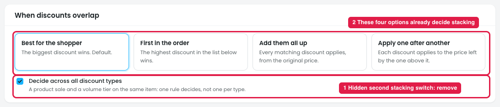
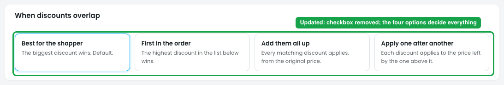

# Stacking: remove the "Decide across all discount types" checkbox

## Issue

**Steps:** Stacking → When discounts overlap → Decide across all discount types

Under the four overlap options sits a checkbox, **"Decide across all discount types"** (marker 1). It changes how all four options work (marker 2):

- **Checked:** every discount on an item competes together, and the overlap rule picks the result.
- **Unchecked:** discounts are grouped by type (sales, volume tiers…). The rule picks a winner **inside each type**, and then **the winners of different types all apply**.

### What happens with "Best for the shopper" + unchecked

6 × Fig candle at $18. Three discounts match: Candle sale 20% off (sale), VIP 15% off (sale), Buy 5+ get 10% off (volume tier).

| | Checked | Unchecked |
|---|---|---|
| How it decides | All three compete; the biggest wins | Sales: 20% beats 15%. Volume: 10%. Both winners apply |
| Discounts given | **1** (20%) | **2** (20% and 10%) |
| Each candle | **$14.40** | $18 → $14.40 → **$12.96** |
| 6 candles | $86.40 | $77.76 |

## Why the checkbox should be removed

1. **"Best for the shopper" stops meaning one discount.** The option says "the biggest discount wins", but with the box unchecked the shopper quietly gets two. The name says one thing and the store does another.
2. **Stacking already has its own options.** "Add them all up" and "Apply one after another" are the stacking choices. The checkbox is a second, hidden way to stack.
3. **It multiplies the combinations.** 4 options × 2 checkbox states = 8 behaviours, and several are hard to predict (e.g. "First in the order" + unchecked gives one winner per type, so not really "first").
4. **The design doesn't say how the type winners combine.** Added up ($12.60) or one after another ($12.96): the price differs, and the owner can't tell from the screen.
5. **The wording is technical.** "Decide across all discount types" doesn't tell the owner what they get. Owners think "Can a tier stack on a sale?", not "decide across types".
6. **Per-discount stacking already exists.** Each discount's Limits step has "Exclusive" and "Only when nothing else applies".

## Suggestion (done in design-v2)

**Steps:** design-v2 → Stacking → When discounts overlap

- **The checkbox is removed.** The store always behaves as if it were checked: every matching discount competes together.
- **The four options alone decide what happens:**
  - **Best for the shopper:** one discount, the biggest.
  - **First in the order:** one discount, the highest in the Order list.
  - **Add them all up:** all discounts stack, each from the original price.
  - **Apply one after another:** all discounts stack, each on the price left.
- **A store that wants a tier on top of a sale** picks one of the two stacking options.
