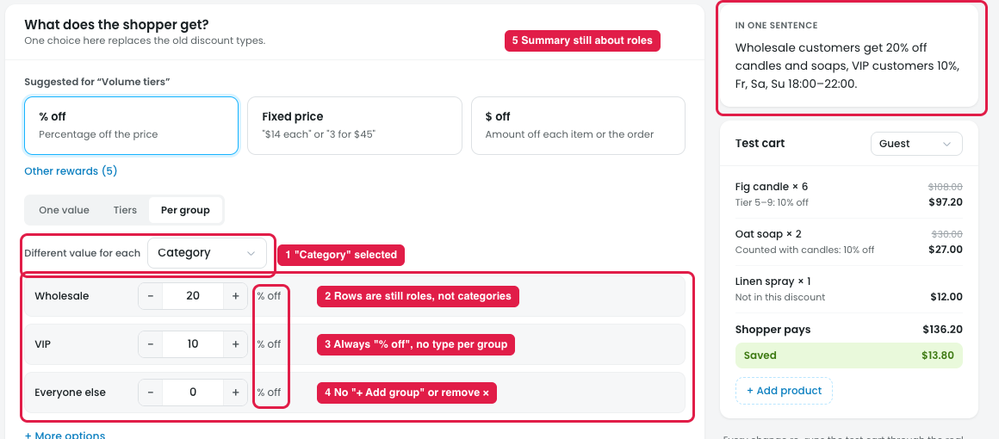
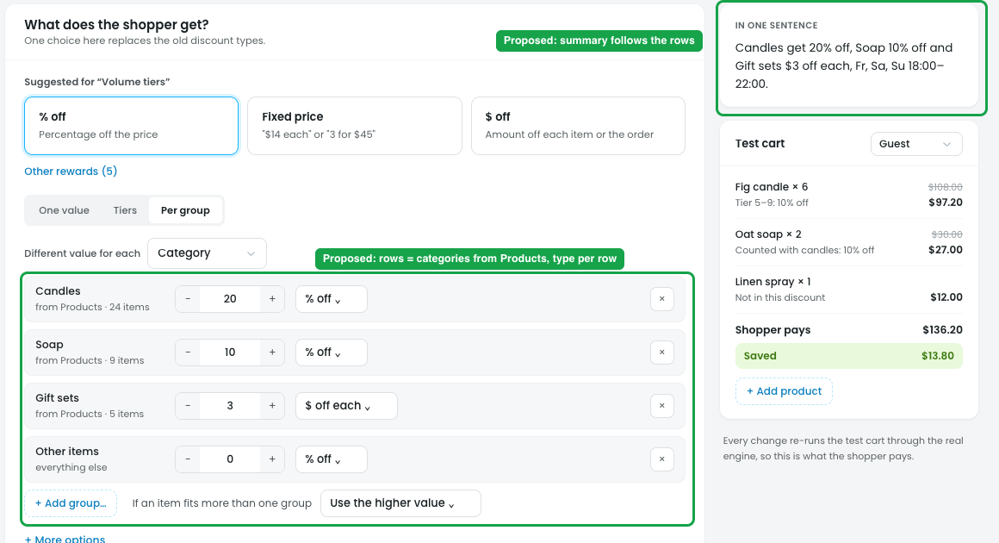
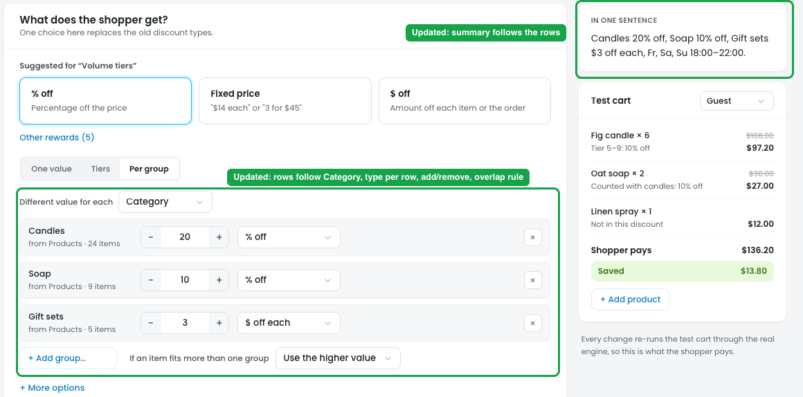

# Reward → Per group: "Category" doesn't change anything

## What "Per group" is for

"Per group" gives **different discount values inside one discount**, so the owner doesn't have to create several discounts. "Different value for each" has two choices:

- **Customer role:** each role gets its own value (Wholesale 20%, VIP 10%, everyone else 0%).
- **Category:** each product category gets its own value (Candles 20%, Soap 10%, other items 0%).

## Issue

**Steps:** Campaigns → Discounts → Buy more, save more → Reward → Per group → Different value for each → Category

1. **"Category" is selected (marker 1), but nothing changes.**
2. **The rows are still roles, not categories (marker 2).** They show Wholesale / VIP / Everyone else.
3. **Every row is "% off" (marker 3).** There's no $ off, $ off each or fixed price per group, unlike tier rows.
4. **Groups can't be added or removed (marker 4).** There's no "+ Add group" and no ×.
5. **The summary still talks about roles (marker 5):** "Wholesale customers get 20% off…, VIP customers 10%".

The design also doesn't say:
- **Which categories appear as rows.**
- **What happens when a product is in two categories** (e.g. a candle in both Candles and Gift sets).
- **What happens when a customer has two roles** (e.g. Wholesale and VIP).

## Scenarios: how it should work

**Scenario 1: different value per category**
Products: Candles, Soap, Gift sets. Per group by Category: Candles 20% off, Soap 10% off, Gift sets $3 off each.

| Cart | Price | Group | Shopper pays |
|---|---|---|---|
| Fig candle | $18 | Candles · 20% off | $14.40 |
| Oat soap | $15 | Soap · 10% off | $13.50 |
| Gift set | $45 | Gift sets · $3 off each | $42.00 |

One discount, three different values. Without Per group, the owner would need three separate discounts.

**Scenario 2: All products + "Other items"**
Products: All products. Per group: Candles 20%, Soap 10%, **Other items 0%**. A $40 hoodie isn't a candle or soap, so it falls into "Other items" and gets no discount. The owner can set "Other items" to e.g. 5% to give everything else a small discount.

**Scenario 3: a product in two categories**
"Fig candle gift box" is in both **Candles (20% off)** and **Gift sets ($3 off each)**, price $30.
- **Use the higher value:** 20% = $6 off beats $3 off, so the shopper pays **$24.00**.
- **Use the first in the list:** Candles is first, so 20% applies and the shopper pays **$24.00**. If Gift sets were first, they'd pay **$27.00**.

**Scenario 4: per role (for comparison)**
Per group by Customer role: Wholesale 20%, VIP 10%, Everyone else 0%. On an $18 candle, a wholesale customer pays $14.40, a VIP pays $16.20 and a guest pays $18.00. A customer who is both Wholesale and VIP gets the value chosen by the overlap rule (higher = 20%).

## Suggestion

**Steps:** Campaigns → Discounts → Buy more, save more → Reward → Per group → Category (proposed)

- **Rows follow the "Different value for each" choice:**
  - **Category:** one row per category picked in Products (Candles, Soap, Gift sets), each with its item count, plus **"Other items"** when Products is "All products" or "All except".
  - **Customer role:** one row per role, plus "Everyone else".
- **A type dropdown in every row:** % off / $ off / $ off each / Fixed price each, the same as tier rows.
- **"+ Add group…" and × on each row,** so the owner can add another category or role, or remove one.
- **An overlap rule:** "If an item fits more than one group: **Use the higher value** (default) / **Use the first in the list**". The same rule handles customers with two roles.
- **The summary follows the rows**, e.g. "Candles get 20% off, Soap 10% off and Gift sets $3 off each".

## Done in design-v2

**Steps:** design-v2 → Campaigns → Discounts → Buy more, save more → Reward → Per group → Category

- **Rows follow "Different value for each":** Category shows the categories from Products (e.g. Candles, Soap), plus "Other items" when Products is All products or All except. Customer role shows Wholesale / VIP / Everyone else.
- **Every row has a value, a type dropdown** (% off / $ off / $ off each / Fixed price each) **and a remove ×.**
- **"+ Add group…"** lists the categories or roles not already used.
- **Overlap rule:** "If an item fits more than one group" (or "If a customer has more than one role"): Use the higher value / Use the first in the list.
- **The summary follows the rows**, e.g. "Candles 20% off, Soap 10% off, Gift sets $3 off each", and for roles "On candles and soaps: Wholesale customers 20% off, VIP customers 10% off".
