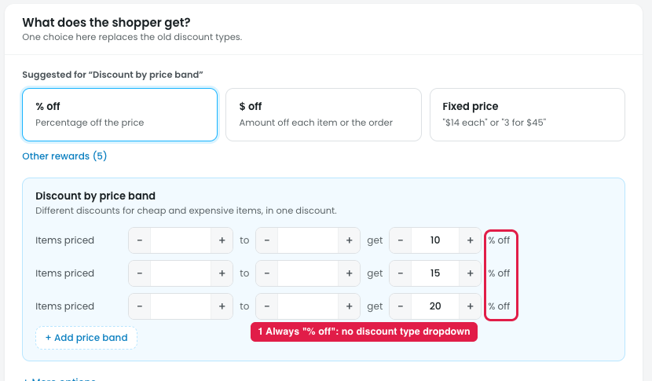
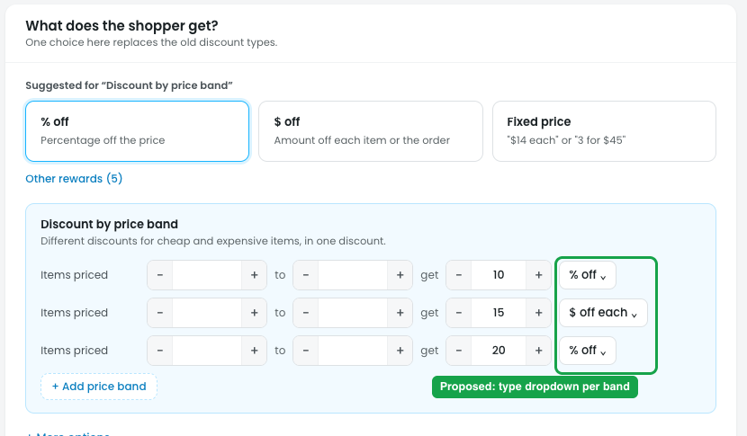
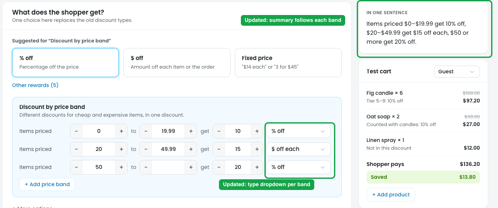

# Discount by price band: "get" should have a discount type dropdown

## Issue

**Steps:** Campaigns → Discounts → New discount → Put products on sale → Discount by price band → Next: Reward

Each price band reads "Items priced [from] to [to] get [10] **% off**". The "% off" is fixed text (marker 1). The owner can't choose another discount type for a band, e.g. "Items over $50 get $10 off each" or "Items under $20 cost a fixed $15".

## Suggestion

**Steps:** Campaigns → Discounts → New discount → Discount by price band → Next: Reward (proposed)

- **Replace the fixed "% off" with a discount type dropdown in every band:** **% off / $ off / $ off each / Fixed price each**, the same list as tier rows and Per group rows.
- **Each band can use its own type**, e.g.:

  | Items priced | Get |
  |---|---|
  | $0 – $20 | 10% off |
  | $20 – $50 | $5 off each |
  | $50 or more | 20% off |

- **The summary follows each band's type**, e.g. "Items under $20 get 10% off, $20–$50 get $5 off each, and $50 or more get 20% off".

## Done in design-v2

**Steps:** design-v2 → Campaigns → Discounts → New discount → Put products on sale → Discount by price band → Next: Reward

- **Every band has a discount type dropdown:** % off / $ off / $ off each / Fixed price each.
- **The band prices now show** (they were empty because "$0" can't go in a number field). The last band's "to" is empty, meaning "or more".
- **The summary follows each band**, e.g. "Items priced $0–$19.99 get 10% off, $20–$49.99 get $15 off each, $50 or more get 20% off".
