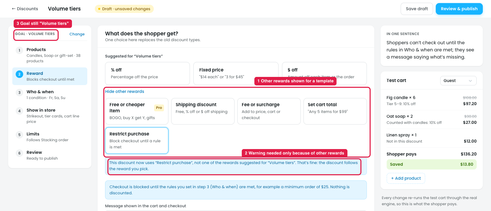

# New discount from a template: "Other rewards" shouldn't be shown

## Issue

**Steps:** Campaigns → Discounts → New discount → Sell more per order → Volume tiers → Next: Reward → Other rewards (5) → Restrict purchase → Switch

A discount made from a template (here **Volume tiers**) shows the rewards suggested for it (% off / Fixed price / $ off), plus an **"Other rewards (5)"** link with Free or cheaper item, Shipping discount, Fee or surcharge, Set cart total and Restrict purchase (marker 1).

1. **The template already decided the goal.** "Volume tiers" means "buy more, pay less". Switching it to Restrict purchase or Fee or surcharge turns it into a completely different discount.
2. **A warning is needed only because of this option (marker 2).** After switching, the design shows "Your 3 tiers will be removed" and then the note "This discount now uses 'Restrict purchase', not one of the rewards suggested for 'Volume tiers'. That's fine…".
3. **The rest no longer matches (marker 3).** The goal still says "GOAL · VOLUME TIERS" and the name is still "Volume tiers", while the reward now blocks checkout.
4. **It adds choices the owner doesn't need.** Templates are meant to make setup quick: "pick a goal, change only what's different".

## Suggestion

- **Discount made from a template:** show only the rewards suggested for that template, and remove the "Other rewards" link. For Volume tiers that's % off / Fixed price / $ off.
- **Start from scratch:** show all rewards. This is where any reward can be picked.
- **Picked the wrong template?** Use **"Change"** next to "GOAL · …" in the step list to go back to the template gallery, instead of switching the reward.
- **With no other rewards, the "Switch to…? Your tiers will be removed" warning and the blue "This discount now uses…" note are no longer needed.**
