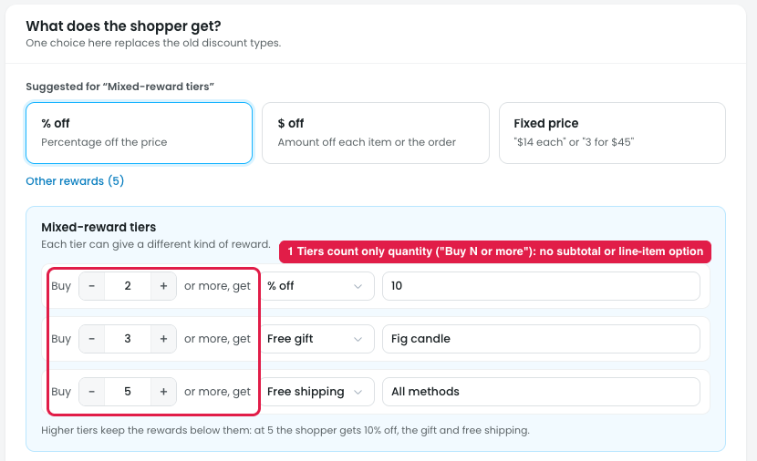
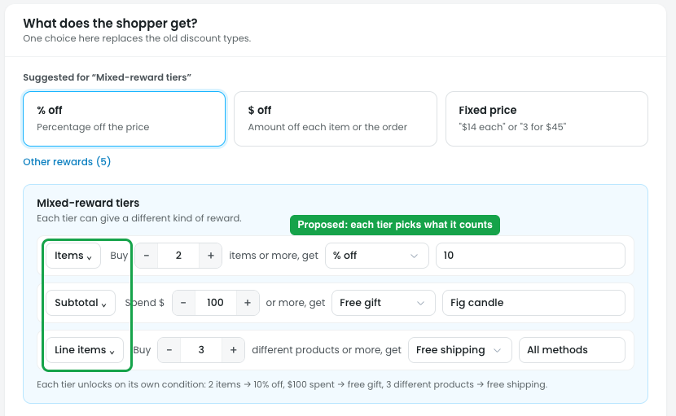

# Mixed-reward tiers: tiers can only count quantity

## Issue

**Steps:** Campaigns → Discounts → New discount → Sell more per order → Mixed-reward tiers → Next: Reward

Every Mixed-reward tier reads **"Buy [N] or more, get [reward]"** (marker 1). It only counts **how many items** the shopper buys. There's no way to base the tiers on:

- **Cart subtotal**, e.g. spend $50 → 10% off, spend $100 → free gift, spend $150 → free shipping
- **Number of line items** (different products in the cart), e.g. 2 different products → 10% off, 3 → free gift

Spend-based mixed rewards are a common pattern ("spend more, unlock more"), so they can't be built with this template today.

## Suggestion

**Steps:** Campaigns → Discounts → New discount → Mixed-reward tiers → Next: Reward (proposed)

- **Every tier row gets its own "counts" dropdown** at the start of the row, so each tier can use a different basis:
  - **Items:** number of items
  - **Subtotal:** cart subtotal ($)
  - **Line items:** number of different products
- **The row label follows its dropdown:**

  | Tier counts | Tier row reads | Example |
  |---|---|---|
  | Items | Buy **[N]** items or more, get… | Buy 2 items or more → 10% off |
  | Subtotal | Spend **$[N]** or more, get… | Spend $100 or more → free gift |
  | Line items | Buy **[N]** different products or more, get… | Buy 3 different products or more → free shipping |

- **Each tier unlocks on its own condition.** Because the tiers can count different things, "higher tiers keep the rewards below them" no longer works as one ladder. Change the helper text to e.g. "Each tier unlocks on its own condition: 2 items → 10% off, $100 spent → free gift, 3 different products → free shipping."
- **The summary lists each tier with its own condition**, e.g. "Buy 2 items: 10% off · Spend $100: free gift · Buy 3 different products: free shipping".
