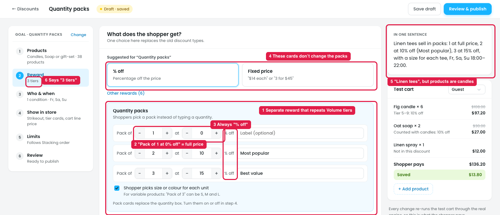

# Quantity packs: a separate reward isn't needed; keep it as a template for Volume tiers

## What it does

"Quantity packs" lets the shopper pick a **pack** instead of typing a quantity, e.g.:

| Pack | Discount | Label |
|---|---|---|
| Pack of 1 | 0% off | — |
| Pack of 2 | 10% off | Most popular |
| Pack of 3 | 15% off | Best value |

It can also let the shopper pick a size or colour for each unit (a Pack of 3 tees in S, M and L), and shows the packs as cards instead of the quantity box.

## Issue

**Steps:** Campaigns → Discounts → New discount → Sell more per order → Quantity packs → Next: Reward

1. **It's a separate reward that repeats Volume tiers (marker 1).** Both give a bigger discount for buying more. The only differences are small:

   | | Volume tiers | Quantity packs |
   |---|---|---|
   | Quantity | Ranges (2–4, 5–9, 10+) | Exact sizes (1, 2, 3) |
   | Shown in store | Tier cards or pricing table | Pack cards |
   | Extra | — | A label per pack; a variation per unit |

   The pack cards display already exists separately in **Show in store → Quantity pack cards**, so the same setup is spread over two screens.
2. **"Pack of 1 at 0% off" is just full price (marker 2).** The row isn't needed.
3. **Every pack is "% off" (marker 3).** There's no $ off / $ off each / fixed price, unlike Tiers.
4. **The % off / Fixed price cards at the top don't change the packs (marker 4).**
5. **The summary is about "Linen tees" (marker 5),** while the products are Candles, Soap or gift-set.
6. **The step list says "3 tiers" (marker 6),** not "3 packs".

## Suggestion

**Remove the separate Quantity packs reward, and keep "Quantity packs" as a template that opens Volume tiers already set up for packs:**

- **Tiers option "Exact quantities (packs)"** instead of From/To ranges: each row reads "Pack of [3] → [15] [% off ▾]".
- **A label field on each tier** ("Most popular", "Best value"), shown on the cards.
- **The type dropdown on each row** (% off / $ off / $ off each / Fixed price each), the same as other tiers.
- **"Shopper picks size or colour for each unit"** as a Tiers option, shown when exact quantities are on.
- **Show in store → Quantity pack cards switched on** by the template.
- **No "Pack of 1" row.** A single item is always full price unless a tier says otherwise.

Owners who sell T-shirts, socks or other multi-packs still find "Quantity packs" in the template gallery, but there's only **one place to set quantity deals: Tiers.**
