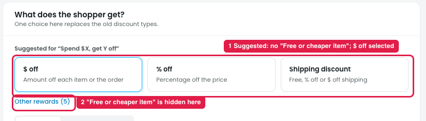

# "Spend $X, get Y off" template: "Free or cheaper item" should be the selected reward

## Issue

**Steps:** Campaigns → Discounts → New discount → Reward bigger carts → Spend $X, get Y off → Next: Reward

1. **The suggested rewards don't include "Free or cheaper item" (marker 1).** The template suggests **$ off** (selected), % off and Shipping discount.
2. **"Free or cheaper item" is hidden under "Other rewards (5)" (marker 2).** To set up "spend $X, get an item free or cheaper", the owner has to open Other rewards and switch, which shows the "not one of the suggested rewards" note.

## Suggestion

- **Make "Free or cheaper item" the selected reward** when this template opens.
- **Show it as a suggested card** (first in the row) for "Spend $X, get Y off", so it's never hidden under Other rewards. Keep $ off and % off as the other suggested cards.
- **Pre-fill it for spending:** "Spend **$[100]** or more → Get **[1]** [item] at **Free**", with the item choice (cheapest / specific products / gift list) from the Free or cheaper item reward.
