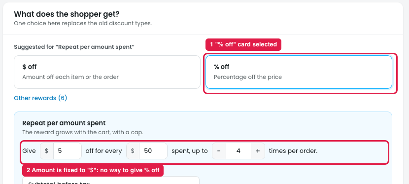
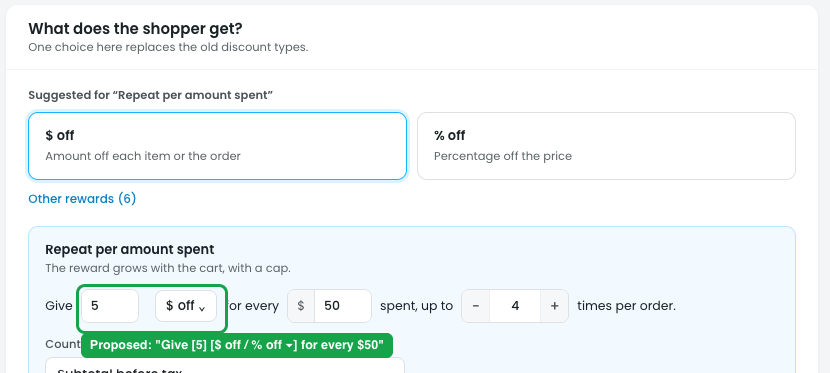

# Repeat per amount spent: let the owner choose $ off or % off

## What it does

"Give **$5 off** for every **$50** spent, up to **4** times per order." The discount grows with the cart, with a cap.

## Issue

**Steps:** Campaigns → Discounts → New discount → Reward bigger carts → Repeat per amount spent → Next: Reward

1. **The template shows a "% off" card (marker 1)**, but selecting it changes nothing.
2. **The amount is fixed to "$" (marker 2):** "Give **$**[5] off for every $[50]". The owner can't give a percentage that grows with the cart, e.g. "5% off for every $50 spent".

## Suggestion

**Steps:** Campaigns → Discounts → New discount → Repeat per amount spent → Next: Reward (proposed)

- **Add a discount type dropdown to the "Give" field:** "Give [5] [**$ off** / **% off** ▾] for every $[50] spent, up to [4] times per order."
- **How each type works** (every $50, up to 4 times):

  | Cart | Steps reached | $ off (give $5) | % off (give 5%) |
  |---|---|---|---|
  | $60 | 1 | $5 off | 5% off ($3.00) |
  | $120 | 2 | $10 off | 10% off ($12.00) |
  | $180 | 3 | $15 off | 15% off ($27.00) |
  | $260 | 4 (cap) | $20 off | 20% off ($52.00) |

  With % off, the percentage grows by 5% for every $50 and applies to the whole cart, up to the cap (here 20%).
- **Keep the dropdown in sync with the $ off / % off cards at the top**, or remove the cards for this template so the type is chosen in one place.
- **The summary follows the type**, e.g. "5% off for every $50 spent, up to 20%".
