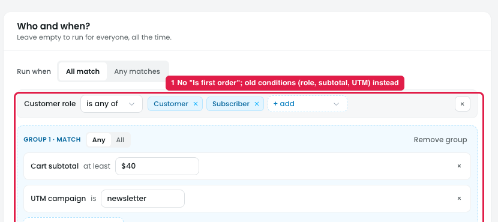
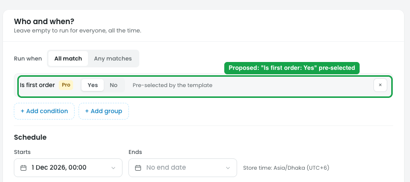

# "First order discount" template: "Is first order" should be pre-selected

## Issue

**Steps:** Campaigns → Discounts → New discount → Reward loyal customers → First order discount → Next: Reward → Next: Who & when

The template is meant for a customer's **first order**, but its Who & when step has **no "Is first order" condition** (marker 1). Instead it shows conditions left over from another discount: Customer role is Customer / Subscriber, and a group with Cart subtotal at least $40 and UTM campaign is newsletter.

As it stands, the discount would apply to **every order** from those customers, not just the first one, unless the owner finds and adds "Is first order" themselves.

## Suggestion

**Steps:** Campaigns → Discounts → New discount → First order discount → Next: Who & when (proposed)

- **Pre-select the condition "Is first order: Yes"** when the template opens, with a short note "Pre-selected by the template".
- **Start with no other conditions.** Don't carry over role, subtotal or UTM conditions from a previous discount.
- **Keep it editable,** so the owner can remove it or add more conditions (e.g. a minimum cart subtotal).
- **Show it in the summary**, e.g. "15% off a customer's first order".
