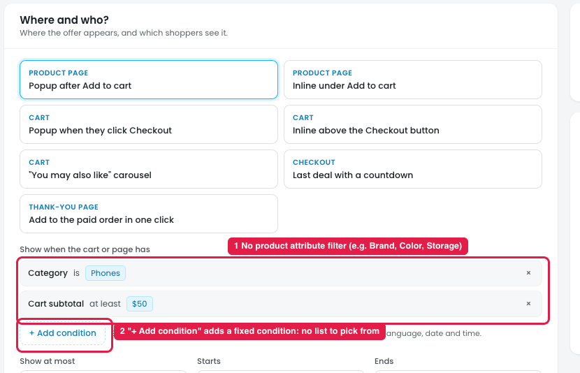
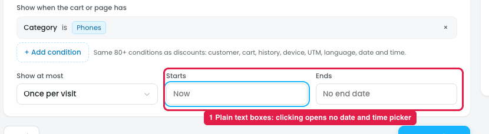
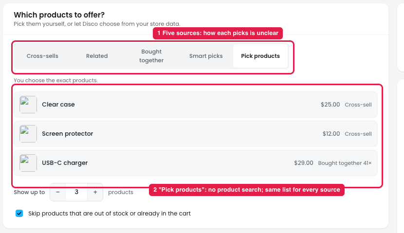
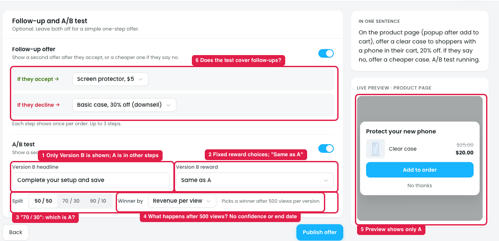
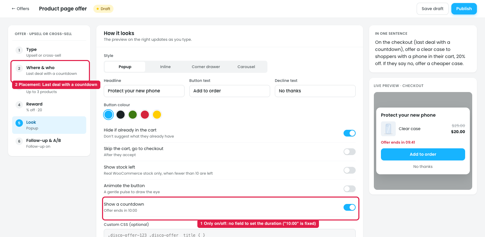

# Product page offer: product attribute filter in "Where & who", and how "Products" picks the offer

A **Product page offer** suggests one more product right after the shopper shows interest, e.g. a shopper adds an iPhone and a popup offers a Clear case at 20% off.

- **Where & who** decides **when** the offer shows (e.g. Category is Phones).
- **Products** decides **what** is offered.

## 1. Where & who: no product attribute filter

**Steps:** Campaigns → Discounts → New discount → Upsell and cross-sell → Product page offer → Next: Where & who → + Add condition

1. **No product attribute filter (marker 1).** The trigger can use Category, but not product attributes such as Brand, Color, Storage or Size. The owner can't target e.g. "Phones where Brand is Apple" or "Phones with 256 GB storage".
2. **"+ Add condition" adds a fixed condition (marker 2).** Clicking it adds "Cart subtotal at least $50" straight away. There's no list to choose a condition from.

### Suggestion
- **"+ Add condition" opens the condition list** (the same picker as discounts), with a **Product** group containing:
  - Product, Category, Tag, Brand
  - **Product attribute** (e.g. Color is Black, Storage is 256 GB)
  - SKU, Price
- **Product attribute rows work like other product rules:** "Attribute [Color ▾] is [Black ×] [+ add]".

## 2. Where & who: Starts and Ends have no date and time picker

**Steps:** Campaigns → Discounts → New discount → Upsell and cross-sell → Product page offer → Next: Where & who → Starts / Ends

1. **Starts ("Now") and Ends ("No end date") are plain text boxes (marker 1).** Clicking them opens no date or time picker, so the owner has to type a date in an unknown format.

### Suggestion
- **Use the same date and time picker as a discount's Schedule** (Who & when → Starts / Ends): a calendar, hour and minute, quick times, "Now" and "No end date" buttons, and Cancel / Apply.
- **Show the store time zone** next to the fields, e.g. "Store time: Asia/Dhaka (UTC+6)".
- **Check that Ends is after Starts.**

## 3. Products: how each source picks the offered products

**Steps:** Campaigns → Discounts → New discount → Upsell and cross-sell → Product page offer → Next: Products

The step has five sources (marker 1). What each one means:

| Source | How the products are chosen | Set by |
|---|---|---|
| **Cross-sells** | The cross-sells set on each product in WooCommerce (Product → Linked products) | Owner, in WooCommerce |
| **Related** | WooCommerce related products: same category or tags | Automatic |
| **Bought together** | Products most often bought with this one in past orders | Automatic, from order history |
| **Smart picks** | Disco picks daily from store data. Signal: Top sellers / Top rated / Recently viewed by this shopper / Similar to the cart / Similar to past orders | Automatic, owner picks the signal |
| **Pick products** | The exact products the owner chooses | Owner, in this step |

Common settings: **Show up to [3] products**, and **Skip products that are out of stock or already in the cart**.

### Issues
1. **How each source picks is unclear (marker 1).** Only one short line explains the selected source, and the list doesn't show where each product came from.
2. **"Pick products" has no product search (marker 2).** It shows the same three products (Clear case, Screen protector, USB-C charger) with no way to search, add or remove products.
3. **The list is the same for every source.** Switching between Cross-sells, Related, Bought together and Smart picks shows the same three products, so the owner can't see what each source would actually offer.
4. **Empty sources aren't handled.** If a product has no cross-sells or no order history, it isn't said what's shown instead.

### Suggestion
- **Pick products: add a searchable product picker** (name or SKU, with image and price), plus × to remove and drag to reorder.
- **Automatic sources: show a live preview** of what that source would offer for an example product (e.g. "For iPhone 15: Clear case, Screen protector, Charger"), labelled with why each was picked.
- **Add a fallback:** "If this source finds nothing, use [Smart picks: Top sellers ▾] / [Don't show the offer]".
- **Add a one-line "how it works" for each source**, as in the table above.

## 4. Follow-up & A/B: the A/B test is confusing

**Steps:** Campaigns → Discounts → New discount → Upsell and cross-sell → Product page offer → Follow-up & A/B → A/B test (on)

1. **Only Version B is shown (marker 1).** Version A's headline ("Protect your new phone") and reward (20% off Clear case) are set in other steps, so A and B can't be compared side by side.
2. **The B reward choices are fixed (marker 2).** "Same as A / Case + protector for $24 / 25% off" are pre-made. The owner can't set their own value or type. "Same as A" with the same headline makes A and B identical, and nothing warns about it.
3. **The split doesn't say which side is A (marker 3).** "70 / 30" doesn't show whether A gets 70%.
4. **The winner rule is unclear (marker 4).** "Picks a winner after 500 views per version" doesn't say whether everyone is switched to the winner automatically or the owner is only notified. There's no confidence level (Insights uses "95% sure" elsewhere), no end date, and "Revenue per view" isn't explained.
5. **The preview shows only A (marker 5).** There's no way to preview Version B.
6. **It's unclear whether the test covers the follow-ups (marker 6).** It doesn't say whether the accept and decline follow-ups are also split, or only the first offer.
7. **No link to results.** It doesn't say where to see A vs B results while the test runs.

### Suggestion
- **Show A and B side by side, both editable**, with the same fields: headline, product, reward type and value.
- **Add a "Preview: A / B" toggle** on the live preview.
- **Label the split clearly:** "A 50% · B 50%", "A 70% · B 30%", "A 90% · B 10%".
- **Define the winner rule:** "When a winner is found: **Switch everyone to it** / **Just notify me**", with a confidence target (e.g. 95%), a minimum number of views, and an optional end date.
- **Explain the metrics:** "Revenue per view = offer revenue ÷ times shown", "Accept rate = accepted ÷ shown".
- **Say what the test covers**, e.g. "Tests the first offer only; follow-ups are the same for A and B".
- **Add a "See results →" link** to the offer's A/B results.
- **Warn when A and B are the same.**

## 5. Checkout "Last deal with a countdown": the timer can't be set

**Steps:** Campaigns → Discounts → New discount → Upsell and cross-sell → Product page offer → Where & who → Checkout: Last deal with a countdown → Look → Show a countdown

1. **The countdown is only on/off (marker 1).** "Show a countdown · Offer ends in 10:00" has no field for the duration, so every countdown is a fixed 10 minutes.
2. **The placement promises a countdown (marker 2),** "Last deal with a countdown", but the timer is only in the Look step, as an optional toggle that's easy to miss.
3. **It isn't defined what happens when the timer ends** (offer hidden, price goes back up, popup closes), or whether it restarts on page reload.

### Suggestion
- **When "Show a countdown" is on, show a "Countdown length" field:** [10] [minutes ▾] (minutes / hours).
- **Add "When the timer ends":** Hide the offer / Show it at full price.
- **Add "Restart on reload": Off (default, the timer keeps running for this shopper) / On.**
- **Turn the countdown on automatically** when the placement is "Last deal with a countdown", and show its length in the Where & who summary ("Last deal · 10 min").
- **Keep it honest:** the timer must be real for each shopper, not reset to fake urgency (EU consumer law).
