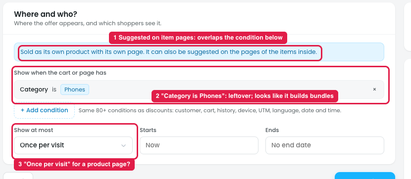
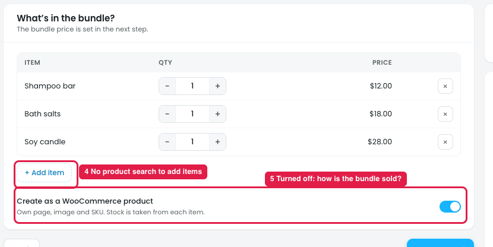
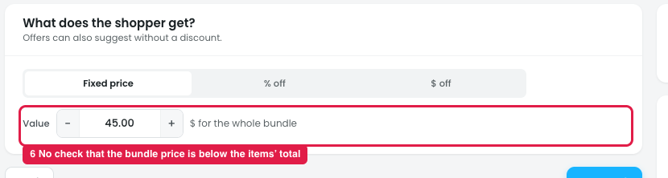

# Offers → Bundle product: what's confusing

## How it works

A **Bundle product** sells a fixed set of products as **one real product** at one price, e.g. "Bath night set": Shampoo bar $12 + Bath salts $18 + Soy candle $28 = $58, sold for **$45** ("Save $13"). Stock comes from each item: if one runs out, the bundle is out of stock.

| Step | What it sets |
|---|---|
| Where & who | Where the bundle is **shown or suggested**, and to whom |
| Products | **What's inside** the bundle (exact items and quantities) |
| Reward | The bundle price (Fixed price / % off / $ off) |

**Important:** a category picked in Where & who **doesn't create bundles**. With Category = Candles (20+ products) and 3 items in Products, the store gets **one** bundle with those 3 items. The category only decides where that one bundle is suggested (pages or carts with any of the 20+ candles).

## Issue 1: Where & who

**Steps:** Campaigns → Offers → New offer → Bundle product → Where & who

1. **"Suggested on the pages of the items inside" (marker 1)** overlaps the condition below. It doesn't say whether the bundle is suggested on the item pages, on pages matching the condition, or both.
2. **"Category is Phones" (marker 2)** is left over from the phone offer. Also, a category here looks like it could build bundles (one per product in the category), but it's only a display condition.
3. **"Show at most: Once per visit" (marker 3)** doesn't fit a product that has its own page and is always there.

## Issue 2: Products

**Steps:** Campaigns → Offers → New offer → Bundle product → Products

4. **"+ Add item" has no product search (marker 4).** It doesn't say how to pick the products in the bundle.
5. **"Create as a WooCommerce product" can be turned off (marker 5),** but it doesn't say how the bundle is sold without its own product page.

## Issue 3: Reward

**Steps:** Campaigns → Offers → New offer → Bundle product → Reward

6. **No check on the bundle price (marker 6).** Nothing warns when the bundle price is equal to or higher than the items' total ($58), so the "bundle" could cost more than buying the items separately.

## Suggestion

- **Rename Where & who for bundles to "Where to suggest it"**, with clear choices:
  - ☑ Its own product page (always)
  - ☑ On the pages of the items inside
  - ☐ On other pages, when the cart or page has: [conditions]
- **Add a note under the conditions:** "This decides where the bundle is suggested. What's inside is set in Products."
- **Start with no conditions,** not leftovers from another offer.
- **Hide "Show at most"** for the product page itself; keep it only for suggestions on other pages.
- **"+ Add item" opens a searchable product picker** (name or SKU, with image and price).
- **Explain the WooCommerce product option:** "Off = the bundle is only offered as a suggestion and added to the cart as separate items at the bundle price."
- **Price check:** show "Items total $58 · Bundle $45 · Shopper saves $13", and warn when the bundle price isn't lower than the items' total.
