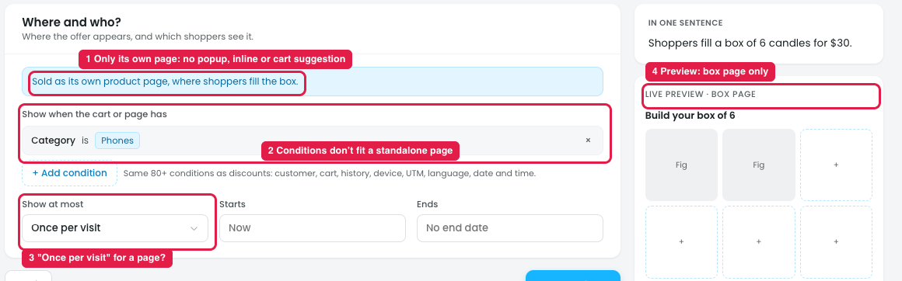
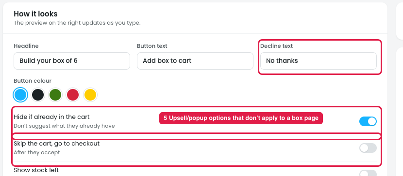

# Offers → Mix & Match box: where does it appear?

## How it works

The shopper **builds their own box** from a set of products at a box price, e.g. "Fill a box of 6 candles for $30". On the box page they tap **+** to fill the slots ("Pick 4 more to fill the box"), then **Add box to cart**.

In the design, the box appears **only as its own product page**. It isn't a popup, and it isn't suggested after another product.

## Issue 1: Where & who

**Steps:** Campaigns → Discounts → New discount → Upsell and cross-sell → Mix & Match box → Where & who

1. **Only its own page (marker 1).** "Sold as its own product page, where shoppers fill the box." There's no popup, inline block or cart suggestion, so shoppers only find the box if they open its page. Bundle product can at least be "suggested on the pages of the items inside"; Mix & Match can't.
2. **The conditions don't fit (marker 2).** "Show when the cart or page has: Category is Phones" is left over from another offer, and it doesn't say what a condition does for a standalone page.
3. **"Show at most: Once per visit" (marker 3)** doesn't make sense for a page that's always there.
4. **The preview shows the box page only (marker 4).** It doesn't say how the box page is created or found: product name, URL, image, or which shop category it appears in.

## Issue 2: Look

**Steps:** Campaigns → Discounts → New discount → Upsell and cross-sell → Mix & Match box → Look

5. **Upsell and popup options (marker 5).** "Decline text", "Hide if already in the cart" and "Skip the cart, go to checkout" are for popups and suggestions. They don't apply to a box page, and they make it look like the box appears as a popup, which it doesn't.

## Suggestion

- **Keep the box page as the main place to fill the box.**
- **Replace Where & who with "Where to promote it":**
  - ☑ Its own product page (always on)
  - ☐ Inline block on the pages of products in the box, e.g. "Build a box of 6 for $30 →"
  - ☐ Popup after Add to cart on those products
  - ☐ Cart suggestion when the cart has 2 or more of those products, e.g. "You have 2 candles; make it a box of 6 for $30"
- **Show the box product's details** in this step: name, URL, image and shop category.
- **Show conditions and "Show at most" only for the promotion placements,** not for the box page itself.
- **Show the upsell options in Look** (Decline text, Hide if already in the cart, Skip the cart) only when a popup or inline promotion is turned on.
- **Preview each placement:** Box page / Inline / Popup / Cart.
