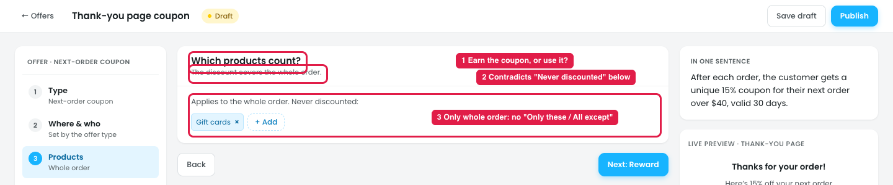
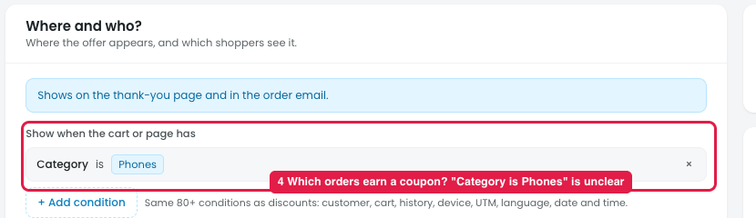

# Offers → Next-order coupon: "Which products count?" is unclear

## How it works

After an order, the customer gets a **unique coupon for their next order**, shown on the thank-you page and in the order email, e.g. "**THANKS-8KQ2**: 15% off your next order over $40, valid 30 days".

A next-order coupon has **two different product questions**:
- **Earn:** which orders give the customer a coupon (e.g. only orders with a phone)
- **Use:** what the coupon discounts on the next order (e.g. the whole order, or only accessories)

## Issue 1: Products

**Steps:** Campaigns → Discounts → New discount → Upsell and cross-sell → Thank-you page coupon → Products

1. **"Which products count?" is ambiguous (marker 1).** It could mean the products that **earn** the coupon or the products the coupon **discounts**. The step only covers the second.
2. **The subtitle contradicts the step (marker 2).** "The discount covers the whole order", but right below is a "Never discounted" list.
3. **The coupon can only cover the whole order (marker 3).** There's no "Only these / All except", so "15% off candles on your next order" can't be made.

## Issue 2: Where & who

**Steps:** Campaigns → Discounts → New discount → Upsell and cross-sell → Thank-you page coupon → Where & who

4. **Which orders earn a coupon is unclear (marker 4).** Every order gets a coupon. The only control is the condition "Show when the cart or page has: Category is Phones" (left over from another offer), and it doesn't say whether that means "this order contained a phone". There's also no "only orders over $X earn a coupon"; the minimum in Reward is for the **next** order.

## Suggestion

- **Split the product settings into two clear parts:**

  | Part | Options |
  |---|---|
  | **Who earns a coupon** (this order) | All orders / Orders with these products or categories / Orders over $[X] |
  | **What the coupon can be used on** (next order) | Whole order / Only these products / All except, with Gift cards excluded by default |

- **Rename the step and subtitle**, e.g. "Earn and use", "Which orders earn a coupon, and what it can be used on".
- **Move the earn rules out of the generic "Show when the cart or page has" conditions,** which read like display rules.
- **Show both in the summary**, e.g. "Orders with a phone over $50 earn 15% off accessories on the next order over $40, valid 30 days".
