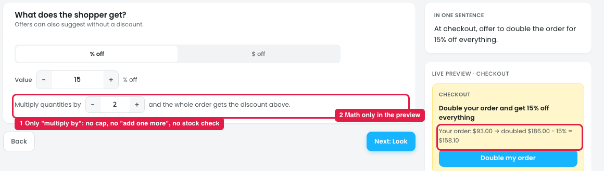
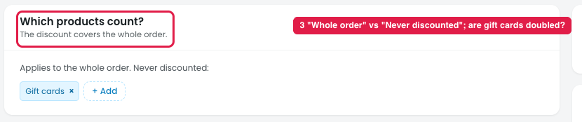
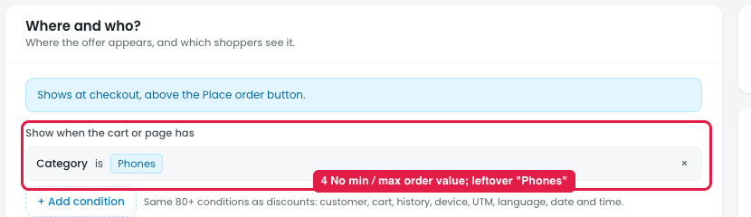
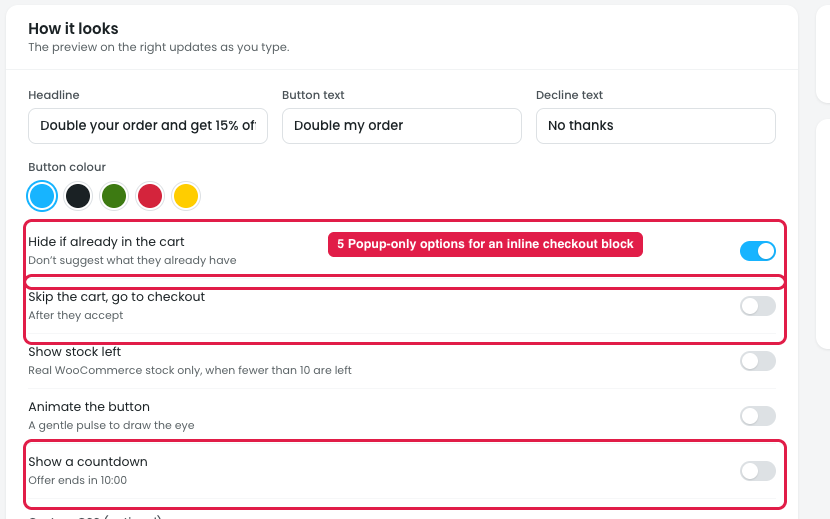

# Offers → Order more, save more: review

## How it works

At checkout, above the Place order button, the shopper is offered to **multiply the whole order** for a discount: "Double your order and get 15% off everything". One click on **Double my order** doubles every quantity (2 candles → 4, 1 soap → 2) and takes 15% off the whole order.

Example from the preview: $93.00 → doubled $186.00 − 15% = **$158.10** (the shopper saves $27.90 on the doubled order).

## Issue 1: Reward

**Steps:** Campaigns → Offers → New offer → Order more, save more → Reward

1. **Only "Multiply quantities by [2]" (marker 1).**
   - There's no "add one more of each" or "reach $X with your own picks".
   - There's no cap: a multiplier of 5 turns a $93 order into $465 with no warning.
   - There's no stock check: it doesn't say what happens when an item doesn't have enough stock for the doubled quantity.
2. **The math is only in the preview (marker 2).** The Reward step doesn't show what the shopper pays or saves, so the owner can't judge whether the offer is profitable.

## Issue 2: Products

**Steps:** Campaigns → Offers → New offer → Order more, save more → Products

3. **"Which products count? The discount covers the whole order" (marker 3)** conflicts with the "Never discounted: Gift cards" list below. It also doesn't say whether excluded items (gift cards) are **doubled** too.

## Issue 3: Where & who

**Steps:** Campaigns → Offers → New offer → Order more, save more → Where & who

4. **No minimum or maximum order value (marker 4).** The offer can't be limited to e.g. orders under $200. The only control is the leftover "Category is Phones" condition.

## Issue 4: Look

**Steps:** Campaigns → Offers → New offer → Order more, save more → Look

5. **Popup-only options (marker 5).** "Hide if already in the cart", "Skip the cart, go to checkout" and "Show a countdown" don't fit an inline block that already sits at checkout.

## Suggestion

- **Let the owner choose what "more" means:**
  - ○ Multiply every item by [2] (max 3)
  - ○ Add [1] more of each item
  - ○ Reach $[X]: the shopper adds their own items
- **Add "If an item doesn't have enough stock: Skip that item / Hide the offer".**
- **Add "Only show for orders between $[min] and $[max]"** in Where & who, and start with no leftover conditions.
- **Show the math in the Reward step:** "Example: $93 → $186, shopper pays $158.10 (saves $27.90)".
- **Make Products clear:** "The discount covers the whole order except: [Gift cards]. Excluded items are not multiplied."
- **Remove the popup-only options** from Look for this placement.
- **Rename the type** "Double your order" or "Multiply your order" so it doesn't sound like a volume tier.
