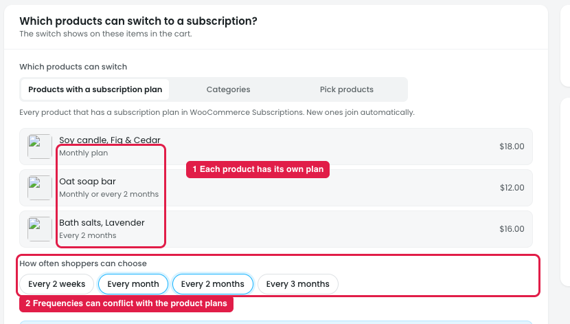
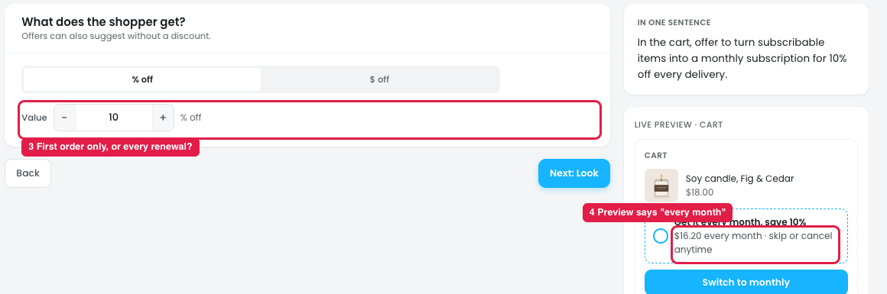
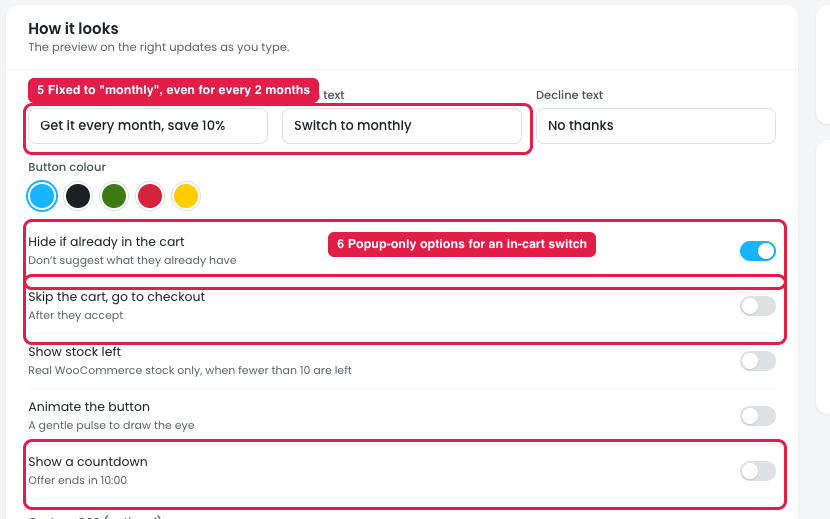
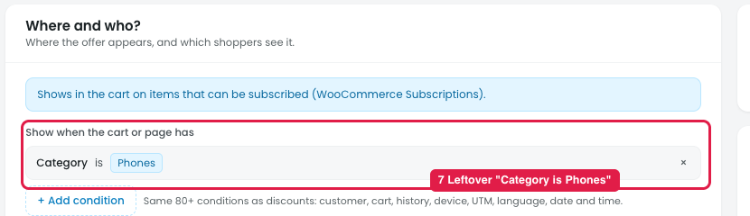

# Offers → Switch to subscription: what's confusing

## How it works

In the cart, under an item that has a subscription plan, the shopper sees: "**Get it every month, save 10%.** $16.20 every month · skip or cancel anytime" **[Switch to monthly]**. If they switch, they pay $16.20 now and $16.20 every month until they skip or cancel. It needs WooCommerce Subscriptions (or a compatible plugin).

## Issue 1: Products and frequencies

**Steps:** Campaigns → Offers → New offer → Switch to subscription → Products

1. **Each product has its own plan (marker 1):** Soy candle monthly, Oat soap monthly or every 2 months, Bath salts every 2 months.
2. **"How often shoppers can choose" can conflict with those plans (marker 2).** Every month and Every 2 months are ticked for all products, but Bath salts only has an every-2-months plan and Soy candle only monthly. It doesn't say what the shopper sees when a ticked frequency isn't in the product's plan.

## Issue 2: Reward

**Steps:** Campaigns → Offers → New offer → Switch to subscription → Reward

3. **It doesn't say how long the discount lasts (marker 3):** the first order only, every renewal, or the first N renewals.
4. **Only the preview says "every month" (marker 4),** so the owner learns the discount applies to every delivery only from the preview.

## Issue 3: Look

**Steps:** Campaigns → Offers → New offer → Switch to subscription → Look

5. **The headline and button are fixed to "monthly" (marker 5):** "Get it every month", "Switch to monthly". If the default or chosen frequency is every 2 months, the text is wrong.
6. **Popup-only options (marker 6):** "Hide if already in the cart", "Skip the cart, go to checkout" and "Show a countdown" don't fit a switch that sits on a cart item.

## Issue 4: Where & who

**Steps:** Campaigns → Offers → New offer → Switch to subscription → Where & who

7. **A leftover "Category is Phones" condition (marker 7)** from another offer. Phones have no subscription plan, so the switch would never show.

## Also unclear

8. **Overlap with the "Subscription discount" template** (Create a discount → Reward loyal customers), which also discounts subscriptions. Owners won't know which one to use.

## Suggestion

- **Use each product's own plan by default:** "Frequencies: **Use each product's plan**" (default), or "Limit to: [Every month] [Every 2 months]…". Only show frequencies a product actually supports.
- **Say how long the discount lasts:** "Discount applies to: **Every delivery** / First order only / First [3] deliveries".
- **Use a frequency tag in the text:** "Get it every [frequency], save [discount]" / "Switch to [frequency]", so it matches the chosen plan.
- **Remove the popup-only options** from Look for this placement.
- **Start with no conditions,** not leftovers from another offer.
- **Explain the difference from the "Subscription discount" template:** this offer converts one-time purchases in the cart; the template discounts existing subscriptions and renewals. Link each from the other.
