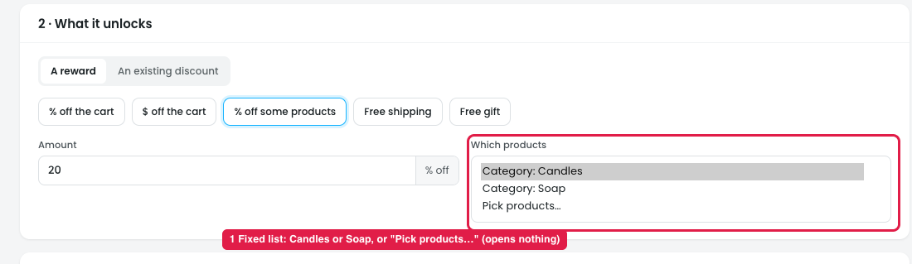
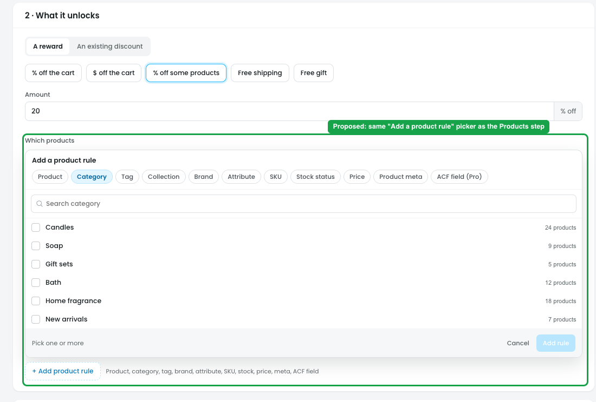
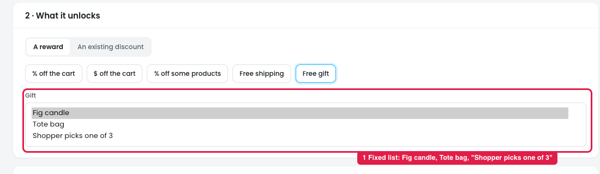
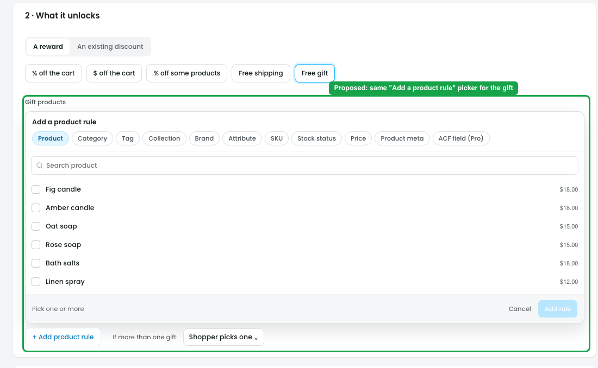
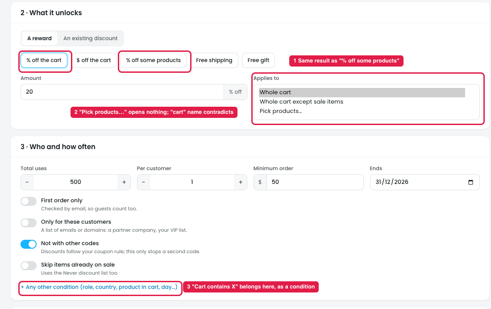
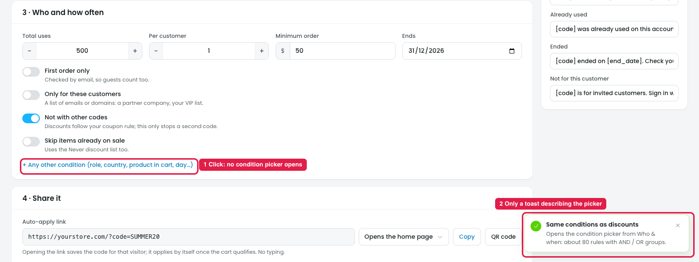
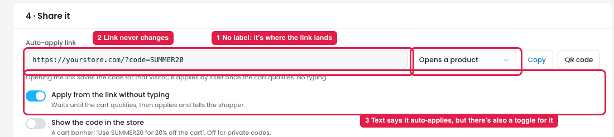
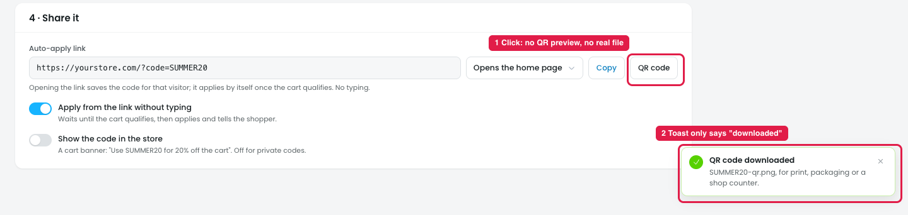
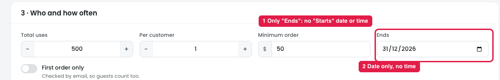

# Coupons → New code: "Which products" should use the product rules from the Products step

## Issue

**Steps:** Coupons → New code → 2 · What it unlocks → A reward → % off some products → Which products

*The dropdown is shown opened for the screenshot.*

When **% off some products** is selected, **Which products** is a single dropdown (marker 1):

- Category: Candles
- Category: Soap
- Pick products… (opens nothing)

Problems:
1. **Only one choice:** the coupon can cover Candles **or** Soap, not both.
2. **A fixed, short list:** no other categories, tags, brands, attributes, SKUs or price ranges.
3. **No exclusions:** no "All except".
4. **"Pick products…" doesn't open a product picker.**
5. **It works differently from discounts,** where the Products step already has full product rules.

## Suggestion

**Steps:** Coupons → New code → 2 · What it unlocks → % off some products → Which products (proposed)

Replace the dropdown with the **same "Add a product rule" picker as the discount Products step**:

- **"+ Add product rule"** opens the picker.
- **Rule types across the top:** Product · Category · Tag · Collection · Brand · Attribute · SKU · Stock status · Price · Product meta · ACF field (Pro).
- **A search box** for the chosen type, e.g. "Search category".
- **A checkbox list with product counts:** Candles (24 products), Soap (9), Gift sets (5), Bath (12), Home fragrance (18), New arrivals (7).
- **"Pick one or more"**, then **Add rule** / **Cancel**.
- **Added rules show as rows**, e.g. "Category is Candles, Soap", and more rules can be added, as in the Products step.

## Same issue in "Free gift"

**Steps:** Coupons → New code → 2 · What it unlocks → A reward → Free gift → Gift

*The dropdown is shown opened for the screenshot.*

When **Free gift** is selected, **Gift** is a dropdown with a fixed list (marker 1): Fig candle / Tote bag / Shopper picks one of 3. The owner can't choose any other product as the gift, and "Shopper picks one of 3" doesn't say which 3 products.

### Suggestion

**Steps:** Coupons → New code → 2 · What it unlocks → Free gift → Gift products (proposed)

- **Use the same "Add a product rule" picker** to choose the gift products (Product · Category · Tag · … with search and checkboxes).
- **When more than one gift is picked**, add "If more than one gift: **Shopper picks one** / Cheapest / Most expensive".

## "% off the cart" → Applies to → "Pick products…"

**Steps:** Coupons → New code → 2 · What it unlocks → A reward → % off the cart (or $ off the cart) → Applies to → Pick products…

*The dropdown is shown opened for the screenshot.*

1. **It gives the same result as "% off some products" (marker 1).** "% off the cart" + Pick products = 20% off only the picked products, which is exactly what the "% off some products" card does. There are two ways to build the same coupon.
2. **"Pick products…" opens nothing, and the name contradicts itself (marker 2).** Choosing it sends the dropdown back to "Whole cart". A "% off the **cart**" that only covers some products is confusing.
3. **For "$ off the cart" the meaning is unclear.** It could mean $10 off spread over the picked products only, or $10 off the cart when it **contains** those products. A "cart contains X" rule is a condition, which belongs in **+ Any other condition → Product in cart** in step 3 (marker 3).

### Suggestion
- **Remove "Pick products…" from "% off the cart" and "$ off the cart".** Cart rewards always cover the whole cart (with "Skip items already on sale" in step 3).
- **For product-specific coupons, use "% off some products"** with the Add a product rule picker (above), and add **"$ off some products"**.
- **For "only when the cart contains X",** use **+ Any other condition → Product in cart**.

## "+ Any other condition" opens nothing

**Steps:** Coupons → New code → 3 · Who and how often → + Any other condition (role, country, product in cart, day…)

1. **Clicking it opens no condition picker (marker 1).** No conditions are added and nothing appears in the step.
2. **Only a toast appears (marker 2):** "Same conditions as discounts · Opens the condition picker from Who & when: about 80 rules with AND / OR groups." It describes the picker but doesn't open it, so the owner can't add role, country, product in cart or day rules to a coupon.

### Suggestion
- **Open the same condition picker as a discount's Who & when step** (search box, condition groups Cart / Customer / Purchase history / Checkout address / Traffic / Date & time / Plugins).
- **Show added conditions as rows** under the toggles, with Run when: All match / Any matches and groups, as in Who & when.
- **Remove the toast.**

## 4 · Share it: the link destination dropdown

**Steps:** Coupons → New code → 4 · Share it → Auto-apply link → Opens the home page / Opens the shop / Opens a product / Opens the cart

The dropdown next to the auto-apply link has: **Opens the home page / Opens the shop / Opens a product / Opens the cart**. It decides **which page the shopper lands on** when they open the link; the code is saved and applied either way.

1. **The dropdown has no label (marker 1),** so it reads like a setting of the coupon, not "where the link lands".
2. **The link never changes (marker 2).** It stays `https://yourstore.com/?code=SUMMER20` for every choice, e.g. "Opens the shop" should give `/shop/?code=SUMMER20`.
3. **"Opens a product" has no product picker,** so it doesn't say which product page the link opens.
4. **"Opens the cart" with an empty cart** lands the shopper on an empty cart page, and nothing warns about it.
5. **The auto-apply text and the toggle repeat each other (marker 3).** The help text already says "it applies by itself once the cart qualifies. No typing", and right below is a toggle "Apply from the link without typing". It isn't clear what turning the toggle off does.

### Suggestion
- **Label the dropdown "Link opens"** and update the link as the choice changes:

  | Link opens | Link |
  |---|---|
  | Home page | yourstore.com/?code=SUMMER20 |
  | Shop | yourstore.com/shop/?code=SUMMER20 |
  | A product | yourstore.com/product/fig-candle/?code=SUMMER20 |
  | Cart | yourstore.com/cart/?code=SUMMER20 |

- **"A product" shows a product search** to choose the page.
- **Warn on "Cart":** "Shoppers with an empty cart land on an empty cart page. Better for emails to existing customers."
- **Merge the help text into the toggle:** "Apply automatically from the link: On = applies once the cart qualifies; Off = the link only fills in the code for the shopper to apply."

## 4 · Share it: "QR code" doesn't work

**Steps:** Coupons → New code → 4 · Share it → QR code

1. **Clicking "QR code" shows no QR code (marker 1).** No preview opens and no file is actually saved.
2. **Only a toast appears (marker 2):** "QR code downloaded · SUMMER20-qr.png, for print, packaging or a shop counter." It says the file was downloaded, but nothing was, and the owner never sees the code before printing it.

### Suggestion
- **Open a QR preview** (popup or panel) showing the code for the current link, e.g. `/shop/?code=SUMMER20`.
- **Add Download PNG / SVG buttons** and a size choice (small / print).
- **Regenerate the QR code** when "Link opens" or the code changes.

## 3 · Who and how often: no start date

**Steps:** Coupons → New code → 3 · Who and how often → Ends

1. **There's only an "Ends" field, no "Starts" (marker 1).** A coupon can't be scheduled ahead, e.g. a Black Friday code created today that only works from 28 Nov. It's live as soon as it's saved.
2. **"Ends" is a date only, with no time (marker 2).** It isn't clear whether the code stops at 00:00 or 23:59 on that day, or in which time zone.

### Suggestion
- **Add "Starts" next to "Ends"**, default "Now".
- **Use the same date and time picker as a discount's Schedule** (calendar, hour and minute, quick times, "Now" / "No end date"), and show the store time zone.
- **Check that Ends is after Starts**, and show the dates in "In plain words", e.g. "…from Nov 28 until Dec 1, 2026, 23:59".
