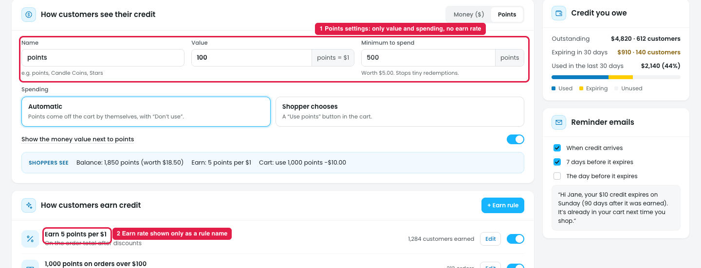
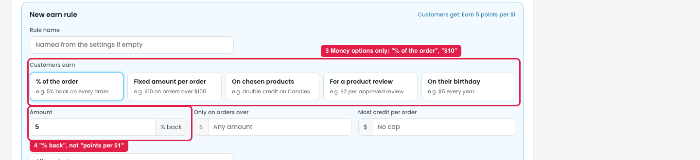
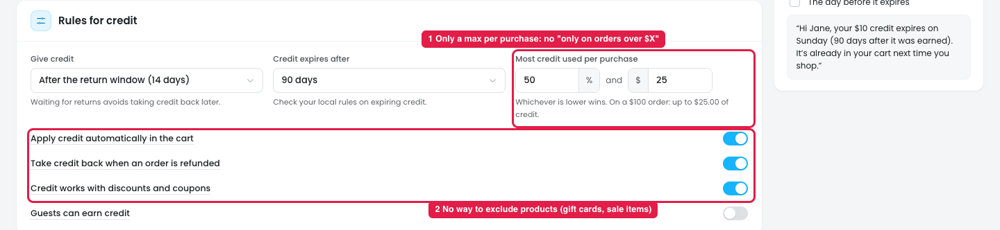

# Credits → Store credit → Points: no clear "points per $ spent" setting

## How it works

Under **How customers see their credit**, the owner can show store credit as **Money ($)** or **Points**. With Points:

- **Name:** e.g. points, Candle Coins, Stars
- **Value:** 100 points = $1 (how much a point is **worth when spent**)
- **Minimum to spend:** 500 points (worth $5)
- **Spending:** Automatic / Shopper chooses

How many points a customer **earns** is set separately, in **How customers earn credit → + Earn rule**.

## Issue

**Steps:** Campaigns → Credits → Store credit → How customers see their credit → Points

1. **The Points settings only set the value and spending (marker 1),** not how many points a customer earns per $ spent. Owners looking for "earn X points per $Y" don't find it here.
2. **The earn rate only shows as a rule name (marker 2):** "Earn 5 points per $1" in the earn rules list.

**Steps:** Campaigns → Credits → Store credit → How customers earn credit → + Earn rule

3. **The earn options are money-based (marker 3):** "% of the order (e.g. 5% back)", "Fixed amount per order (e.g. $10)", "$2 per approved review", "$5 every year". None say "points".
4. **The amount is "% back" (marker 4),** not "points per $1". The owner has to work out that 5% back with 100 points = $1 equals 5 points per $1. The header "Customers get: Earn 5 points per $1" is the only place that translates it.

So the earn rate **exists in the design**, but it's hidden behind money wording and a conversion the owner has to do in their head.

## Suggestion

- **When Points is selected, earn rules use points wording:**

  | Earn type | Money mode | Points mode |
  |---|---|---|
  | On every order | [5] % back | Earn **[5] points per $[1]** spent |
  | Fixed per order | $[10] on orders over $100 | **[1,000] points** on orders over $100 |
  | Product review | $[2] per review | **[200] points** per review |
  | Birthday | $[5] every year | **[500] points** every year |

- **Show the money value next to it:** "5 points per $1 = 5% back".
- **Add the default earn rate to the Points settings:** "Customers earn [5] points per $[1] spent (edit in earn rules →)", so value and earn rate sit together.
- **Keep "Shoppers see" as the live summary:** "Earn: 5 points per $1 · 100 points = $1".

## Money credit: spending rules are missing two controls

**Steps:** Campaigns → Credits → Store credit → How customers see their credit → Money ($) → Rules for credit

Credit is money the customer **earned before** and spends later. A discount based on the cart total ("Spend $100, get $10 off") is a normal discount and already exists as the **"Spend $X, get Y off"** template, so Credits doesn't need its own. But the rules for **using** credit are missing two controls:

1. **No minimum cart total to use credit (marker 1).** There's only "Most credit used per purchase: [50]% and $[25]". The owner can't say "credit can only be used on orders over $30", so a shopper can spend $5 credit on a $5 order and pay nothing.
2. **No product exclusions for spending credit (marker 2).** The toggles cover auto-apply, refunds and combining with discounts, but not **which products** credit can pay for, e.g. not on gift cards (credit → gift card → cash) or sale items.

### Suggestion
- **Add "Only usable on orders over $[30]"** next to "Most credit used per purchase".
- **Add "Credit can't be used on: [Gift cards ×] [+ Add]"**, using the same "Add a product rule" picker, with Gift cards excluded by default.
- **Show both in the example line:** "On a $100 order: up to $25.00 of credit. Not usable on orders under $30 or on gift cards."
