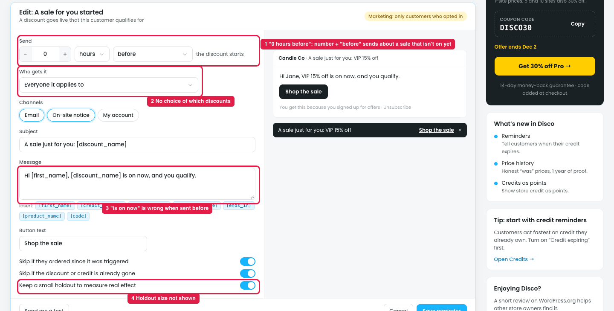

# Reminders → "A sale for you started" → Edit: what's unclear

## How it works

When a discount **goes live** and a customer **qualifies for it** (e.g. a VIP when "VIP 15% off" starts), Disco tells that customer by email, on-site notice or in My account. It's a marketing reminder, so only customers who opted in get it.

| Field | Default | What it does |
|---|---|---|
| Send | [0] hours · right when it happens · the discount starts | When to send: right away, or N hours/days before or after the discount starts |
| Who gets it | Everyone it applies to | Everyone who qualifies / VIP only / spent over $200 / ordered in the last 6 months |
| Channels | Email · On-site notice | Email, on-site bar or toast, My account |
| Subject / Message / Button | "A sale just for you: [discount_name]" / "Hi [first_name], [discount_name] is on now, and you qualify." / "Shop the sale" | Text, with tags filled in per customer |
| Skip rules | On | Skip if they ordered since; skip if the discount is already gone |
| Holdout | On | A small group doesn't get it, to measure the real effect |

## Issue

**Steps:** Reminders → Discounts → A sale for you started → Edit

1. **"Before" only works for scheduled discounts, but the screen doesn't say so (marker 1).** Sending **before** the discount starts is a useful teaser when the discount has a **start date and time** (e.g. a Black Friday sale set to start 28 Nov 00:00, emailed 1 day before). But for a discount that starts as soon as it's published, there's no "before", and nothing tells the owner what happens then (sent right away? skipped?). Also, the number field shows even with "right when it happens", where it does nothing, and "0 hours before" is allowed.
2. **There's no choice of which discounts it covers (marker 2).** It fires for **every** discount the customer qualifies for, so a store with several sales can send many emails (only the weekly cap limits it).
3. **The message says "is on now" (marker 3),** which is wrong when the reminder is sent before the discount starts.
4. **The holdout size isn't shown (marker 4).** "Keep a small holdout" doesn't say how many customers are held back.

## Suggestion

- **Send timing:** keep "before" for scheduled discounts, with a note: "Before: only for discounts with a start date. Discounts that start on publish are sent right when they start." Show the number only for before or after, and don't allow 0.
- **Add "Which discounts":** All discounts / Only these discounts [pick], so the owner can send it for e.g. Black Friday only.
- **Make the default message follow the timing:** "starts in [starts_in]" for before, "is on now" for right away or after. Add a [starts_in] tag.
- **Show the holdout size:** "Keep [10]% as a holdout to measure the real effect".
