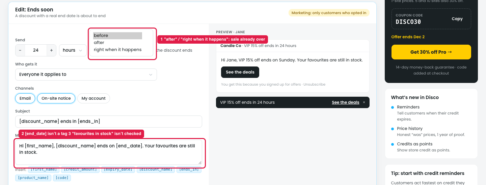

# Reminders → "Ends soon" → Edit: what's unclear

## How it works

Reminds customers that a discount they qualify for is **about to end**. It only applies to discounts with a **real end date**, and only customers who opted in get it.

| Field | Default |
|---|---|
| Send | [24] hours · before · the discount ends |
| Who gets it | Everyone it applies to |
| Channels | Email · On-site notice |
| Subject | "[discount_name] ends in [ends_in]" |
| Message | "Hi [first_name], [discount_name] ends on [end_date]. Your favourites are still in stock." |
| Button | "See the deals" |

Example: Winter clearance ends 31 Jan 23:59, so 24 h before, qualifying customers get "Winter clearance ends in 24 hours".

## Issue

**Steps:** Reminders → Discounts → Ends soon → Edit

*The timing dropdown is shown opened for the screenshot.*

1. **"after" and "right when it happens" don't fit (marker 1).** Sending N hours after the discount ends, or when it ends, tells customers about a sale that's already over. Only "before" makes sense.
2. **The message uses [end_date], which isn't a tag (marker 2).** The Insert list has [expiry_date] and [ends_in], but not [end_date].
3. **"Your favourites are still in stock" isn't checked (marker 2).** Nothing looks at the customer's favourites or the stock, so the default text can be untrue.
4. **No choice of which discounts** it covers (same as "A sale for you started", note 42).

## Suggestion

- **Timing:** only offer "before"; remove "after" and "right when it happens" for this reminder.
- **Tags:** add [end_date] to the Insert list (or change the default to [ends_in]).
- **Default message:** remove "Your favourites are still in stock", or show it only when a real check is added.
- **Add "Which discounts":** All / Only these discounts.
