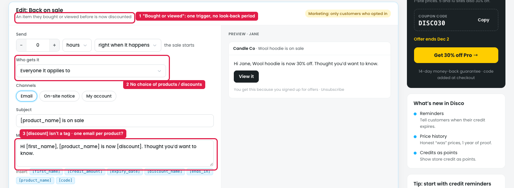

# Reminders → "Back on sale" → Edit: what's unclear

## How it works

Emails a customer when **an item they bought or viewed before is now discounted**. It's a marketing reminder (opt-in only) and is **Off** by default.

| Field | Default |
|---|---|
| Send | [0] hours · right when it happens · the sale starts |
| Who gets it | Everyone it applies to |
| Channels | Email |
| Subject | "[product_name] is on sale" |
| Message | "Hi [first_name], [product_name] is now [discount]. Thought you'd want to know." |
| Button | "View it" |

Example: Jane viewed the Wool hoodie last week. When "Winter clearance 30% off Hoodies" starts, she gets "Wool hoodie is now 30% off. [View it]".

## Issue

**Steps:** Reminders → Discounts → Back on sale → Edit

1. **"Bought or viewed" is one trigger, with no look-back period (marker 1).**
   - The owner can't choose viewed only, bought only, or both.
   - "Bought" doesn't suit one-time items: emailing Jane that the hoodie she just bought is now cheaper invites refund requests.
   - It doesn't say how far back a view or purchase counts.
   - "Viewed" only works for logged-in customers or stored browsing history.
2. **No choice of products or discounts (marker 2).** It fires for every product and every discount.
3. **The message uses [discount], which isn't a tag (marker 3).** The Insert list only has [discount_name].
4. **Several products on sale at once (marker 3).** If 5 viewed items go on sale together, it doesn't say whether that's 5 emails or one email listing them.

## Suggestion

- **Split the trigger:** "Remind about items they: ☑ Viewed ☐ Bought ☐ Added to wishlist", with "in the last [30] days".
- **Note for "Viewed":** "Logged-in customers only."
- **Add "Which products / discounts":** All / Only these.
- **Add a [discount] tag** (e.g. "30% off"), or change the default text to use an existing tag.
- **Combine multiple items into one email:** "Wool hoodie and 4 more items you viewed are now on sale".
