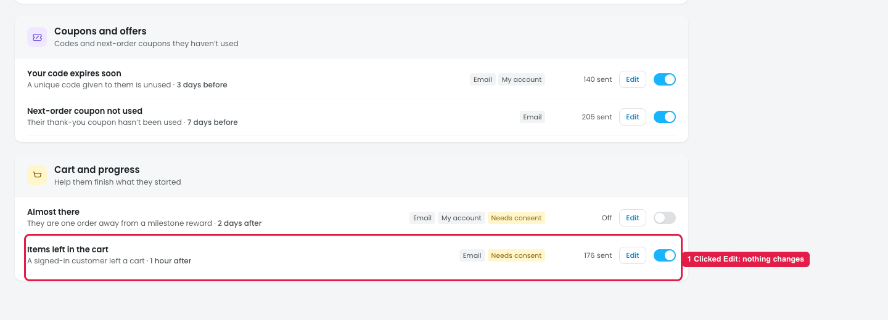
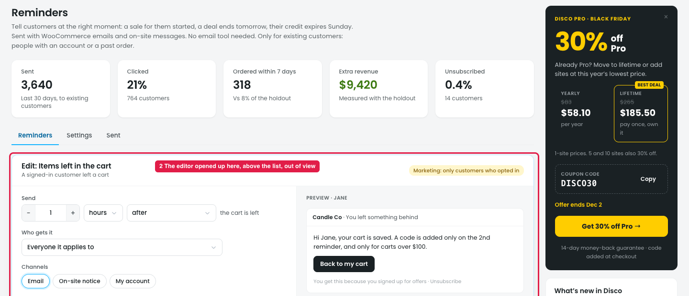
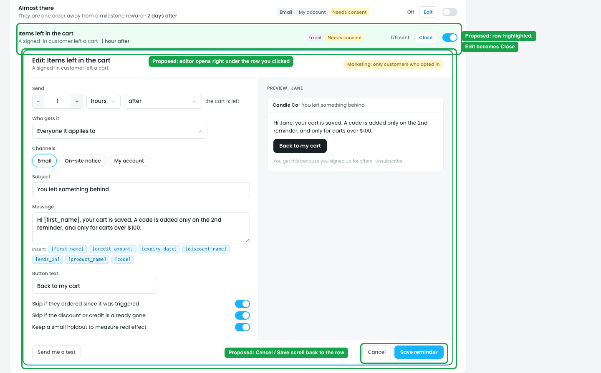

# Reminders → Edit: the editor opens at the top of the page, out of view

## Issue

**Steps:** Reminders → Reminders tab → scroll down to any reminder (e.g. Cart and progress → Items left in the cart) → Edit

1. **Clicking Edit seems to do nothing (marker 1).** The page doesn't scroll, the row isn't highlighted, and the Edit button doesn't change. The owner thinks the button is broken and clicks again.
2. **The editor opens above the whole list (marker 2),** under the Reminders / Settings / Sent tabs. The owner has to scroll back up to find it, and from there can't see which row they're editing. The list also moves down by the editor's height.
3. **After Cancel or Save reminder,** the editor closes at the top and the owner has to scroll back down to the row they were on.

## Suggestion

**Steps:** Reminders → Reminders tab → Cart and progress → Items left in the cart → Edit (proposed)

- **Open the editor right under the row that was clicked,** like an accordion. Only one editor is open at a time, so opening another one closes the first.
- **Highlight the row that's being edited,** and change its **Edit** button to **Close**.
- **Scroll the editor into view** if it doesn't fit on screen.
- **After Cancel or Save reminder,** close the editor and keep the owner at that row, with a "Saved" toast.
- If the editor stays at the top, scroll the page to it and focus its heading when Edit is clicked. Opening it under the row is still better.
