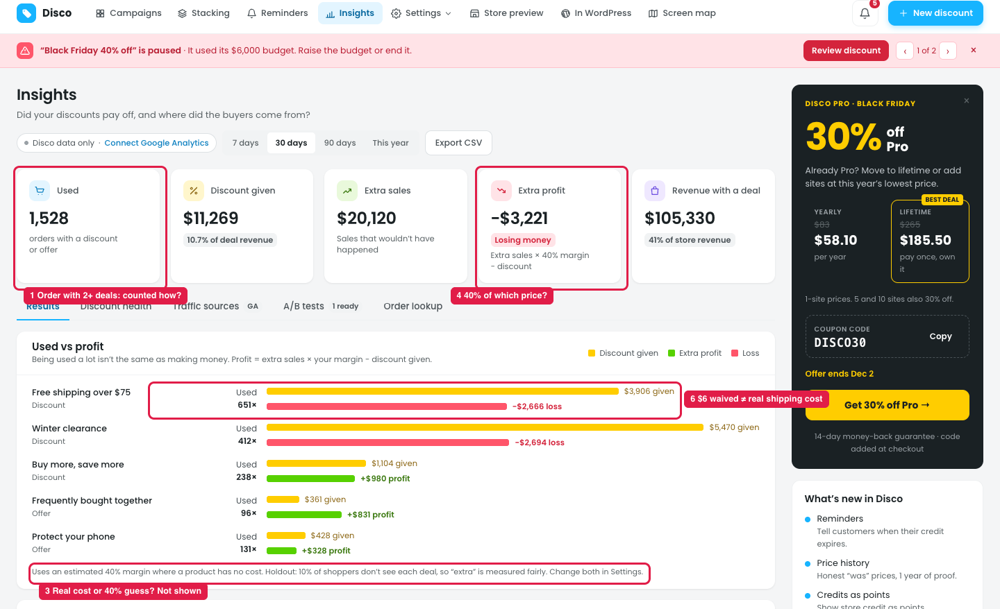
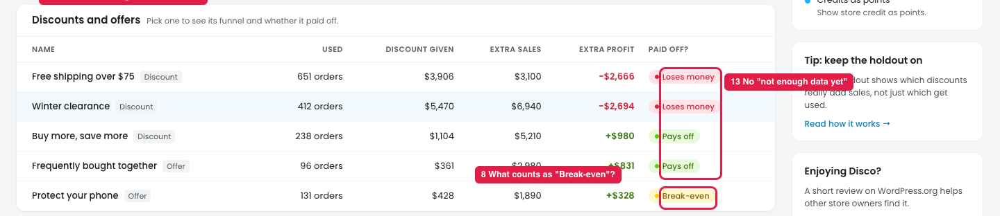
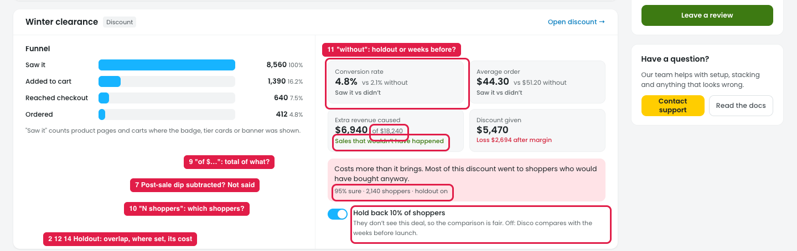
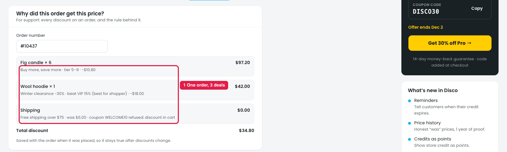
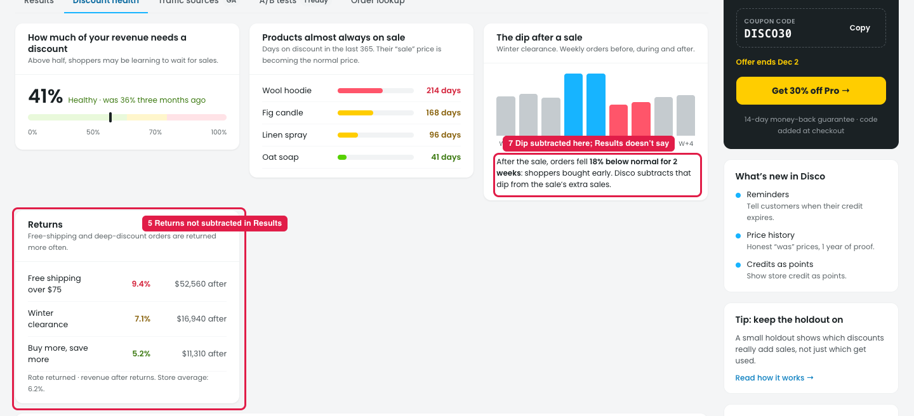

# Insights → Results: how the numbers are calculated is confusing

The numbers in the prototype are placeholder data. This note covers only what's confusing about how they're calculated and explained, not the values themselves or the look of the page.

**How it works:** Extra profit = Extra sales × margin − Discount given. Extra sales are measured by hiding each deal from 10% of shoppers (the holdout).

## Cards and "Used vs profit"

**Steps:** Insights → Results

1. **An order with 2+ deals (marker 1).**
   - Confusing: one order can use several deals (see Order lookup below). "Used" doesn't say whether that order counts once or once per deal, or how its sales and profit are split between the deals.
   - Suggestion: count each order once in the total. Split a shared order between its deals (e.g. by discount share), and say so: "Orders with 2+ deals are split by discount share."
3. **Real cost or a guess (marker 3).**
   - Confusing: profit uses each product's cost, or an estimated 40% when there's none. The page doesn't show how much of the result is estimated.
   - Suggestion: show coverage next to profit, e.g. "Real cost for X% of items · rest estimated at 40%", linking to Settings → Margin & cost.
4. **Margin on which price (marker 4).**
   - Confusing: "Extra sales × 40% margin" doesn't say whether the margin is taken from the regular price or the price after discount.
   - Suggestion: say "Margin is applied to the price the shopper paid".
6. **Other costs (marker 6).**
   - Confusing: for free shipping, "given" is the shipping charge waived, not what shipping really costs the store. Payment fees and free gift items aren't mentioned.
   - Suggestion: use the real shipping cost (set in Settings) and include gift item costs, or say they're not included.

## Table

**Steps:** Insights → Results → Discounts and offers

8. **"Pays off / Break-even / Loses money" (marker 8).**
   - Confusing: there's no rule for when a deal counts as break-even.
   - Suggestion: define it, e.g. "Break-even = within ±$X or ±Y% of discount given", and show the rule in a tooltip.
13. **Too little data (marker 13).**
   - Confusing: a deal with few shoppers still gets a verdict. Confidence only shows in the detail panel.
   - Suggestion: add "Not enough data yet (needs about N shoppers)" instead of a verdict.

## Deal detail

**Steps:** Insights → Results → Discounts and offers → pick a deal

2. **The holdout overlaps between deals (marker 2).**
   - Confusing: a shopper held back from one deal still sees the other deals, so "without" isn't really without deals.
   - Suggestion: use one shared holdout (a group that sees no deals), or say that results include the effect of other deals.
7. **Post-sale dip (marker 7).**
   - Confusing: Discount health says the dip after a sale is subtracted, but "Extra revenue caused" doesn't say whether it's already included.
   - Suggestion: show it, e.g. "Post-sale dip subtracted: −$X".
9. **"of $…" (marker 9).**
   - Confusing: "Extra revenue caused $X of $Y" doesn't say what $Y is.
   - Suggestion: label it, e.g. "of $Y total sales from orders that used this deal".
10. **"N shoppers" (marker 10).**
   - Confusing: "95% sure · N shoppers" doesn't say which shoppers: the holdout, everyone who saw it, or both.
   - Suggestion: "Based on N shoppers who saw it and M in the holdout".
11. **What "without" means (marker 11).**
   - Confusing: "vs X% without" could come from the holdout or from the weeks before launch, which is used when the holdout is off.
   - Suggestion: say which, e.g. "without = holdout" or "without = 4 weeks before launch".
12. **Where the holdout is set (marker 12).**
   - Confusing: each deal has a "Hold back 10% of shoppers" toggle, but the Results footnote says "Change both in Settings". It doesn't say what happens to past results when it's switched off.
   - Suggestion: keep it in one place, point the footnote there, and keep past results labelled ("Measured with holdout until [date]").
14. **The holdout's cost (marker 14).**
   - Confusing: holding back 10% of shoppers loses some sales (with free shipping, they pay shipping), but that cost isn't shown.
   - Suggestion: show "Holding back cost about $X in sales this period".

## Order lookup: one order, several deals

**Steps:** Insights → Order lookup

One order with 3 deals (marker 1), so Results needs a rule for counting and splitting it (point 1).

## Discount health: returns and the dip

**Steps:** Insights → Discount health

5. **Returns (marker 5).**
   - Confusing: returns are shown here, but Results doesn't say whether returned orders are removed from extra sales.
   - Suggestion: use sales after returns in Results, or say "before returns".
7. **The dip (marker 7)** is explained only here, not in Results (point 7).
