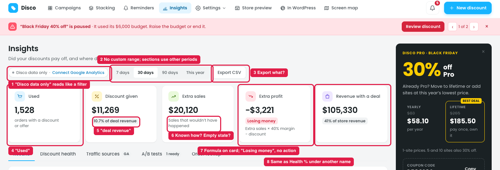

# Insights: header and summary cards (from the store owner's view)

## Issue

**Steps:** Insights

1. **"Disco data only · Connect Google Analytics" reads like a filter (marker 1).** It's actually the data source.
2. **The period filter (marker 2)** has no custom range and no "compared to the previous period". Some sections below use other periods (last 365 days, three months ago, 12 months) and don't say they ignore the filter.
3. **"Export CSV" doesn't say what's exported (marker 3):** the current tab, all tabs, or every order.
4. **"Used" is vague (marker 4).**
5. **"deal revenue" (marker 5)** adds another word for the same thing. The page uses deal / discount / offer, and sales / revenue, as if they were different.
6. **"Sales that wouldn't have happened" (marker 6)** doesn't say how Disco knows. There's also no empty state for a new store with no holdout data yet.
7. **The Extra profit card (marker 7)** shows a formula as its subtitle, and "Losing money" scares the owner (the orders themselves made a profit). There's no next step.
8. **"Revenue with a deal · % of store revenue" (marker 8)** is the same idea as Discount health's "How much of your revenue needs a discount", but with a different name.

## Suggestion

| # | Now | Proposed |
|---|---|---|
| 1 | Disco data only · Connect Google Analytics | **Source: Disco** · + Add Google Analytics (for traffic sources) |
| 2 | 7 days · 30 days · 90 days · This year | Add **Custom** and **vs previous period**. Sections that ignore the filter get a label: *"Last 12 months · not affected by the date filter"* |
| 3 | Export CSV | **Export this tab (CSV)** |
| 4 | Used · orders with a discount or offer | **Orders with a deal** |
| 5 | Discount given · % of deal revenue | **Given away** · % of sales with a deal |
| 6 | Extra sales · Sales that wouldn't have happened | **Extra sales** · Added by deals (measured with a holdout) ⓘ. With no data yet: *"Collecting data. Results appear after about 2 weeks or 500 shoppers."* |
| 7 | Extra profit · Losing money · Extra sales × 40% margin − discount | **Net gain from deals** · *Deals gave away more than they added* · **[See which]**. Move the formula into the ⓘ tooltip |
| 8 | Revenue with a deal · % of store revenue | **Sales with a deal** · % of all sales, with the same name in Discount health |

**Use one word for each idea across Insights:**
- **Deal** = a discount or an offer
- **Sales**, not "revenue"
- **Extra sales**
- **Net gain / Net loss**
