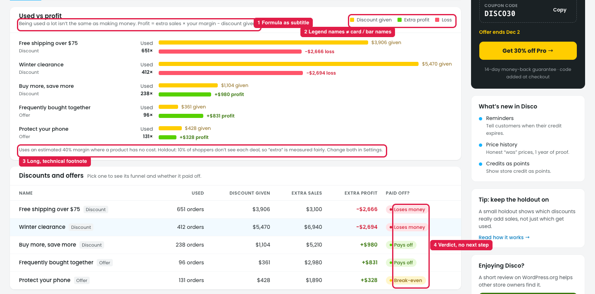
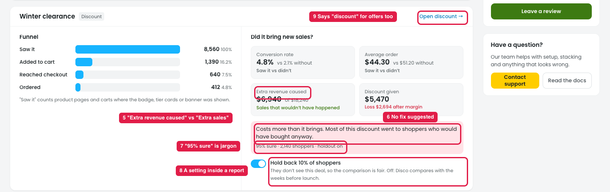

# Insights → Results: wording and next steps (from the store owner's view)

How the numbers are calculated is covered in note 46. This note is about wording and what the owner should do next.

## Issue 1: Chart and table

**Steps:** Insights → Results

1. **The chart subtitle is a formula (marker 1):** "Profit = extra sales × your margin − discount given."
2. **The names don't match (marker 2).** The legend says "Extra profit / Loss", the bars say "profit / loss", and the card says "Extra profit".
3. **The footnote is long and technical (marker 3).** It mixes margin, holdout and "Change both in Settings" in one line with no links.
4. **The "Paid off?" verdicts give no next step (marker 4).** "Loses money" doesn't tell the owner what to change.

## Issue 2: Deal detail

**Steps:** Insights → Results → Discounts and offers → pick a deal

5. **"Extra revenue caused" (marker 5)** is the same idea as the card's "Extra sales".
6. **The verdict box explains the problem but not the fix (marker 6).**
7. **"95% sure" is statistics jargon (marker 7).**
8. **A setting sits inside a report (marker 8).** The owner can switch off "Hold back 10% of shoppers" by accident while reading.
9. **"Open discount →" also shows for offers (marker 9).**

## Suggestion

| # | Now | Proposed |
|---|---|---|
| 1 | Being used a lot isn't the same as making money. Profit = extra sales × your margin − discount given. | Popular isn't the same as profitable. **Green**: the deal earned more than it gave away. **Red**: it gave away more than it earned. |
| 2 | Discount given · Extra profit · Loss | **Given away · Net gain · Net loss**, the same on bars, cards and table |
| 3 | Uses an estimated 40% margin where a product has no cost. Holdout: 10%… Change both in Settings. | Two lines with links: *"Profit uses your product costs; 40% where a cost is missing. [Set costs]"* / *"10% of shoppers don't see each deal, so we can compare. [Change]"* |
| 4 | Loses money | **Loses money → Fix**, which opens suggestions: raise the minimum spend, lower the %, or end the deal |
| 5 | Extra revenue caused | **Extra sales** |
| 6 | Costs more than it brings. Most of this discount went to shoppers who would have bought anyway. | Add: **"Try:** add a minimum spend of $[X], or limit it to new customers. **[Edit deal]**" |
| 7 | 95% sure · N shoppers | **Confidence: High** (95%) · based on N shoppers |
| 8 | Hold back 10% of shoppers [toggle] | Move the toggle to the deal's settings. Show a status here: *"Holdout on · [Change in deal]"* |
| 9 | Open discount → | **Open deal →**, or *Open offer →* for offers |
