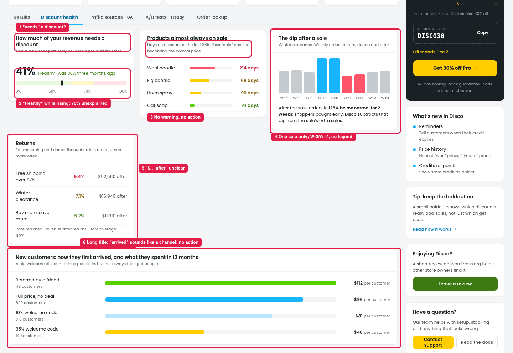

# Insights → Discount health (from the store owner's view)

## How it works

The tab checks whether discounts are hurting the store in the long run:

| Section | What it answers |
|---|---|
| Revenue that needs a discount | Share of all sales made with a discount. Is the store hooked on discounts? |
| Products almost always on sale | Days each product was discounted in the last 365. Is its "sale" price now the real price? |
| The dip after a sale | Weekly orders before, during and after a sale. Did the sale create sales, or just move them earlier? |
| Returns | Return rate for each deal. Which deals bring orders that come back? |
| New customers | 12-month spend by the deal used on the first order. Which welcome deal brings customers who keep buying? |

## Issue

**Steps:** Insights → Discount health

1. **"How much of your revenue needs a discount" (marker 1).** "Needs" says the discount caused the sale, which isn't known.
2. **"Healthy · was 36% three months ago" (marker 2).** It says "Healthy" while the share is rising. The bar has a 70% mark that isn't explained.
3. **"Products almost always on sale" (marker 3)** has no warning and no action. It doesn't mention that a regular price that's rarely used may not count as a real "was" price.
4. **"The dip after a sale" (marker 4)** shows one sale only, with no way to pick another. W-3 … W+4 aren't explained, and there's no colour legend (grey / blue / red).
5. **Returns (marker 5).** "$… after" is unclear. The subtitle states something as a general fact ("…are returned more often").
6. **New customers (marker 6).** The title is long, "how they first arrived" sounds like a traffic channel (that's Traffic sources), and there's no action.

## Suggestion

| # | Now | Proposed |
|---|---|---|
| 1 | How much of your revenue needs a discount | **Share of sales made with a discount** |
| 2 | Healthy · was 36% three months ago | **Healthy, but rising** (36% three months ago). Label the bar **Healthy · Watch · Too high** |
| 3 | Days on discount in the last 365. Their "sale" price is becoming the normal price. | **On sale most of the year.** Their regular price may no longer count as a real "was" price, which some countries require. **[See price history] [Pause discount]** |
| 4 | The dip after a sale · Winter clearance… | **Orders before, during and after: [Winter clearance ▾]**, with a legend **Normal · Sale · Dip**, and *"Shoppers bought early: orders dropped 18% for 2 weeks after. We removed this dip from the sale's extra sales."* |
| 5 | Returns · …returned more often · "$… after" | **Returns by deal.** *Deals with high returns add fewer real sales.* Columns: **Returned · Sales after returns**, with the store average in each row |
| 6 | New customers: how they first arrived, and what they spent in 12 months | **New customers: first-order deal vs 12-month spend**. Add *"Try: a smaller welcome code brings customers who spend more. [Edit welcome code]"* |

Also: say each section's period ("Last 365 days", "Last 12 months"), because these sections don't follow the top date filter.
