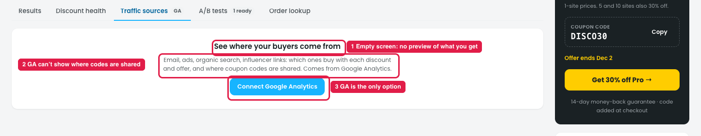

# Insights → Traffic sources (from the store owner's view)

## Issue

**Steps:** Insights → Traffic sources

1. **It's an empty "Connect" screen (marker 1).** The owner can't see what they'd get before connecting.
2. **It promises something Google Analytics can't do (marker 2):** "…and where coupon codes are shared. Comes from Google Analytics." GA doesn't know which sites a coupon code was posted on.
3. **GA is the only option (marker 3).** A store without GA, or one that doesn't want to share data with Google, gets nothing.

## Suggestion

| # | Now | Proposed |
|---|---|---|
| 1 | See where your buyers come from + a button | Show a blurred sample table behind the button: **Source · Orders · Deal used · Net gain** |
| 2 | …and where coupon codes are shared. Comes from Google Analytics. | *"…which channels buy with each deal."* Show coupon sharing separately: **"Coupon sharing: see which sites your codes are posted on (from Disco, no GA needed)."** |
| 3 | Connect Google Analytics | **Basic sources from Disco** (UTM tags and referrers saved with each order), plus **+ Add Google Analytics for more detail** |
