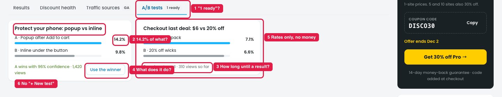

# Insights → A/B tests (from the store owner's view)

## Issue

**Steps:** Insights → A/B tests

1. **The tab badge "1 ready" (marker 1).** "Ready" doesn't say that a test has a winner.
2. **The percentage isn't named (marker 2).** It doesn't say what 14.2% measures: took the offer, added to cart, or ordered.
3. **"Too close to call · N views so far" (marker 3)** doesn't say how long until there's a result.
4. **"Use the winner" doesn't say what it does (marker 4):** whether the test ends, the losing version is turned off, or it can be undone.
5. **Only rates are compared, not money (marker 5).** The version more people take can still earn less, e.g. a bigger discount.
6. **There's no way to start a test here (marker 6),** and no link to the deal being tested.

## Suggestion

| # | Now | Proposed |
|---|---|---|
| 1 | 1 ready | **1 winner** |
| 2 | A · Popup after Add to cart · 14.2% | A · Popup after Add to cart · **14.2% took the offer** |
| 3 | Too close to call · N views so far | Too close to call · about **N more views needed** (≈ 5 days) |
| 4 | Use the winner | **Use popup for everyone**, then confirm: *"The test ends and Inline is turned off. You can start a new test anytime."* |
| 5 | (rates only) | Add **Net gain per 1,000 views** for each version, and pick the winner on money, not only on rate |
| 6 | (none) | **+ New A/B test** (pick a deal and what to test), and make each test title link to its deal |
