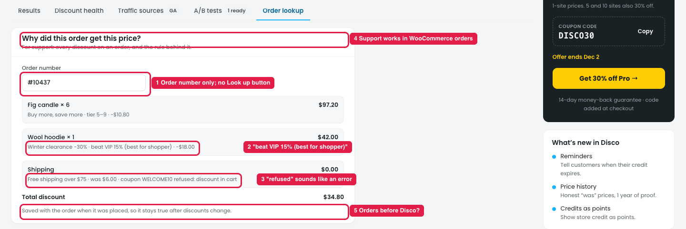

# Insights → Order lookup (from the store owner's view)

## Issue

**Steps:** Insights → Order lookup

1. **Search by order number only, with no Look up button (marker 1).** Support usually has the customer's email or name, not the order number.
2. **"beat VIP 15% (best for shopper)" is jargon (marker 2).**
3. **"coupon WELCOME10 refused: discount in cart" sounds like an error (marker 3),** and it doesn't link to the rule that blocked it.
4. **Support staff work in WooCommerce → Orders, not in Disco Insights (marker 4).** They have to leave the order to find this.
5. **"Saved with the order when it was placed" (marker 5)** doesn't say what happens with orders placed before Disco was installed.

## Suggestion

| # | Now | Proposed |
|---|---|---|
| 1 | Order number [#10437] | **Order number, customer email or name** + **[Look up]** |
| 2 | Winter clearance −30% · beat VIP 15% (best for shopper) | Winter clearance 30% used **instead of** VIP 15%: **bigger saving for the shopper**. [Stacking rule] |
| 3 | coupon WELCOME10 refused: discount in cart | Coupon WELCOME10 **not applied**: it can't be combined with other discounts. **[See rule]** |
| 4 | (Insights only) | Add the same **"Why this price"** box to the WooCommerce order page |
| 5 | Saved with the order when it was placed, so it stays true after discounts change. | Add: *"Orders placed before Disco was installed (12 Oct) have no details."* |
