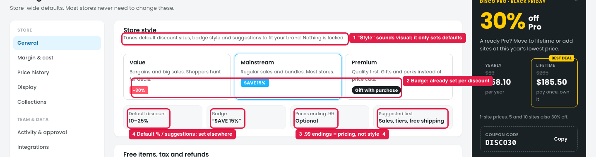
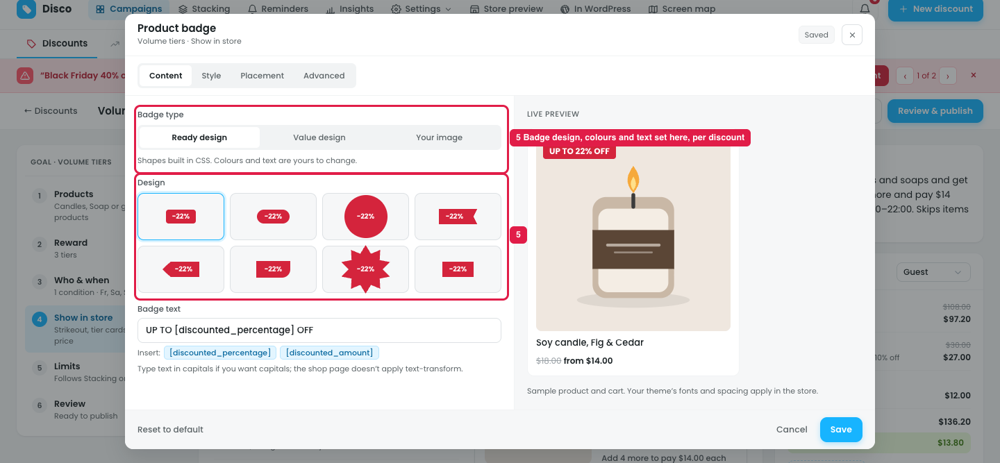
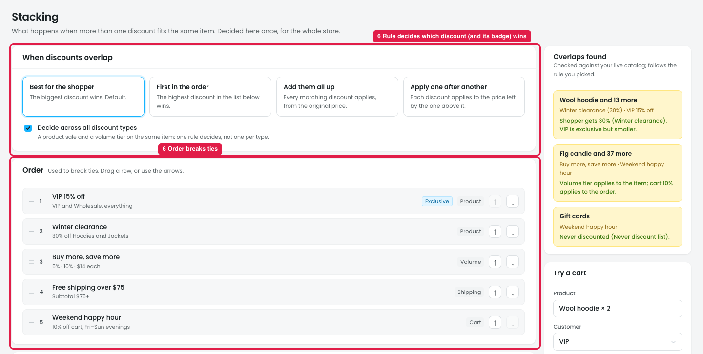
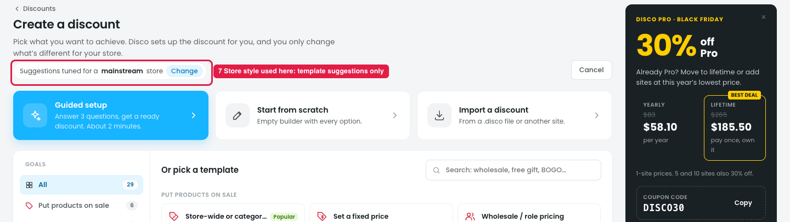

# Settings → General → Store style: not needed

## How it works

Store style (Value / Mainstream / Premium) is a preset for **new** discounts. It sets:

| | Value | Mainstream | Premium |
|---|---|---|---|
| Default discount | 20–30% | 10–25% | 10% or none |
| Badge | Loud "−30%" in red | "SAVE 15%" | Quiet "Special price" |
| Prices ending .99 | On | Optional | Off (round prices) |
| Suggested first | % off, BOGO, tiers | Sales, tiers, free shipping | Gifts, free shipping, early access |

It's asked in the setup wizard and shown on Create a discount ("Suggestions tuned for a mainstream store · Change"). It doesn't change existing discounts.

## Issue

### Store style in Settings

**Steps:** Settings → General → Store style

1. **"Style" sounds visual, but it only sets starting values (marker 1).** "Tunes default discount sizes, badge style and suggestions to fit your brand" makes owners expect it to change how the store looks. Changing it shows no visible change, because existing discounts stay the same.
2. **The badge is already decided elsewhere (marker 2).** Each discount sets its own badge in Show in store (marker 5). When several discounts match a product, Stacking decides which discount wins, so **that discount's badge** shows (marker 6). Store style's loud / quiet badge has no job in that flow.
3. **".99 price endings" is a pricing rule, not style (marker 3),** but it's hidden inside Store style.
4. **The default % and "Suggested first" are already covered (marker 4).**
   - Each template has its own default amount, and the owner sets it in the Reward step.
   - Create a discount already has goals (Put products on sale, Give something free…) to filter templates.

### The badge in each discount

**Steps:** Campaigns → Discounts → New discount → Volume tiers → Show in store → Product badge → Edit

5. **Badge type, design, colours and text are set per discount here (marker 5),** with Content / Style / Placement tabs and a live preview.

### Which badge shows

**Steps:** Stacking

6. **"When discounts overlap" and "Order" decide which discount applies to a product (marker 6),** so they also decide whose badge the shopper sees.

### Where Store style is used

**Steps:** Campaigns → Discounts → New discount

7. **Its only visible use is "Suggestions tuned for a mainstream store · Change" (marker 7),** which only reorders the templates.

## Suggestion

- **Remove Store style from Settings → General.**
- **Badge:** keep it per discount (Show in store → Product badge). Stacking already picks which discount's badge shows. Optional: a store-wide **"Default badge design"** in **Settings → Display** that new discounts start from, with "Using the store default · [Change for this discount]" in the badge editor.
- **.99 endings:** move to **Settings → General → Pricing**, as "Price endings: .99 / Round / Keep as is".
- **Template suggestions:** if they're kept, ask "What kind of store are you?" once in the **setup wizard**, and use the answer only to order templates. Change "Suggestions tuned for a mainstream store · Change" so it opens that wizard question, or remove it.
