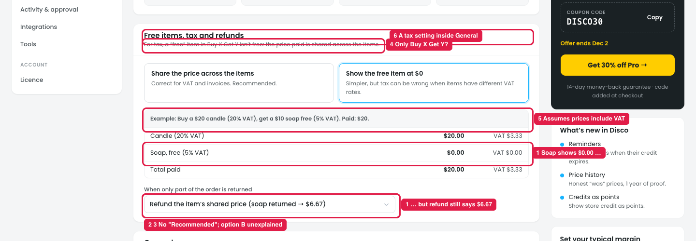

# Settings → General → Free items, tax and refunds: what's confusing

## How it works

In Buy X Get Y, the "free" item isn't free for tax. The shopper paid for both items together. This section decides how that price appears on the order and invoice:

- **Share the price across the items** (recommended): the paid price is split by each item's normal price. Buy a $20 candle and get a $10 soap free: the candle shows $13.33 and the soap $6.67, so each item is taxed at its own VAT rate.
- **Show the free item at $0:** the candle shows $20.00 and the soap $0.00. Simpler, but VAT is wrong when the items have different rates.

**When only part of the order is returned** is a dropdown:
- "Refund the item's shared price (soap returned → $6.67)", or
- "Refund nothing for a free item; take back the deal if the paid item returns".

## Issue

**Steps:** Settings → General → Free items, tax and refunds → Show the free item at $0

1. **The refund rule doesn't follow the option picked (marker 1).** With "Show the free item at $0", the soap shows **$0.00**, but the refund dropdown still says "soap returned → **$6.67**". A refund of $6.67 for an item shown at $0 doesn't make sense.
2. **No refund choice is marked "Recommended" (marker 2),** unlike the two tax options above it.
3. **"Take back the deal if the paid item returns" isn't explained (marker 3).** It's unclear whether the shopper is refunded $20 − $10, must send the free item back too, or the return is blocked.
4. **It only mentions Buy X Get Y (marker 4).** It doesn't say whether it also applies to BOGO, Cheapest item free, Free gift (shopper chooses), bundles, or a coupon's free gift.
5. **The example assumes prices include VAT (marker 5),** as in the EU. For stores that add tax on top (e.g. US sales tax), the example doesn't apply and the choice is harder to understand.
6. **A tax and accounting setting sits in General (marker 6),** next to unrelated settings like timezone and coupon attempts.

## Suggestion

- **Make the refund rule follow the option:**
  - Share the price → "Refund the item's shared price (soap → $6.67)".
  - $0 → "Free item returned: refund $0. Paid item returned: take back the deal."

  Show only the matching rule, or update its example when the option changes.
- **Mark the recommended refund choice** (the shared price).
- **Explain "take back the deal" with the example:** *"Candle returned: the shopper is refunded $20 − $10 = $10, or returns both items for $20."*
- **List the deals it covers:** *"Applies to: Buy X Get Y, BOGO, Cheapest item free, Free gift, bundles and coupon gifts."*
- **Match the example to the store's tax setting:** VAT included (EU), or tax added on top (US), using the WooCommerce tax settings.
- **Move it to its own "Tax & refunds" section** in Settings (or next to Margin & cost), not General.
