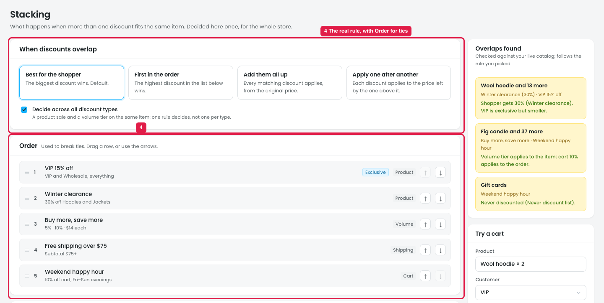
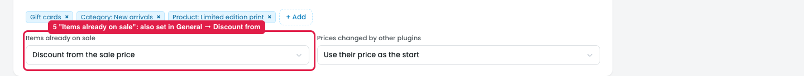

# Settings → General: "When discounts overlap" and "Discount from" repeat Stacking

## Issue

### In Settings → General

**Steps:** Settings → General → General (How discounts are calculated)

1. **"When discounts overlap" repeats the Stacking rule (marker 1).** The same 4 choices (Best for the shopper / First in the order / Add them all up / Apply one after another) are in both places.
   - In the prototype they aren't connected: changing General to "First in the order" leaves Stacking on "Best for the shopper".
   - The owner can't tell which one is the real setting.
2. **It contradicts itself (marker 2):** "Full controls live in Stacking", but the control is here too. "First in the order" also needs the Order list, which only exists in Stacking.
3. **"Discount from" repeats Stacking → "Items already on sale" (marker 3, marker 5),** and the two show different values:
   - General: **Regular price**
   - Stacking: **Discount from the sale price**

### In Stacking

**Steps:** Stacking → When discounts overlap / Order

4. **Stacking already has the full rule (marker 4):** the 4 choices, "Decide across all discount types", the Order list for ties, Overlaps found, and Try a cart. Its heading says "Decided here once, for the whole store."

**Steps:** Stacking → Items already on sale

5. **"Items already on sale" (marker 5)** sets the same thing as General → Discount from, with more choices: sale price, regular price, skip them, or whichever is cheaper.

## Suggestion

- **Remove "When discounts overlap" from Settings → General.** If a reminder is wanted, show it read-only with a link: *"When discounts overlap: **Best for the shopper** · [Change in Stacking]"*.
- **Remove "Discount from" from General too,** or show it read-only the same way: *"Items already on sale: **Discount from the sale price** · [Change in Stacking]"*. Each discount can still change it in its own steps.
- Keep each store-wide rule in **one place** (Stacking), so the two can never disagree.
