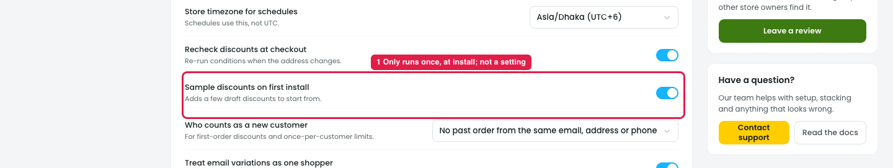

# Settings → General → "Sample discounts on first install": remove it

## Issue

**Steps:** Settings → General → General → Sample discounts on first install

1. **It's a setting for something that only happens once (marker 1).** "Adds a few draft discounts to start from" runs at the first install. By the time the owner can open Settings, Disco is already installed, so turning it on or off changes nothing.
   - It's on by default, so a new store's Discounts list starts with drafts the owner didn't create, and has to review or delete them.
   - Starting points already exist: **Create a discount** has Guided setup and 29 templates, each pre-filled with sensible defaults.

## Suggestion

- **Remove "Sample discounts on first install" from Settings.**
- Don't add sample drafts at install. New owners start from **Create a discount → Guided setup** or a template, which create only what they choose.
