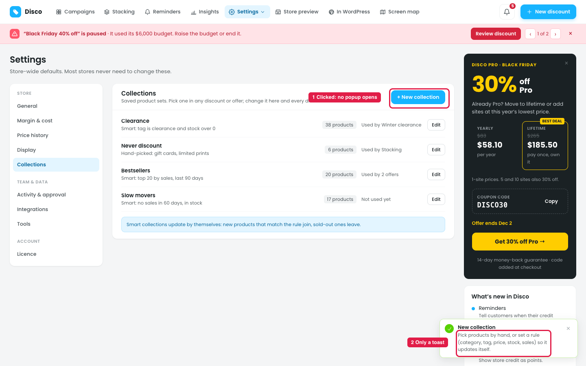
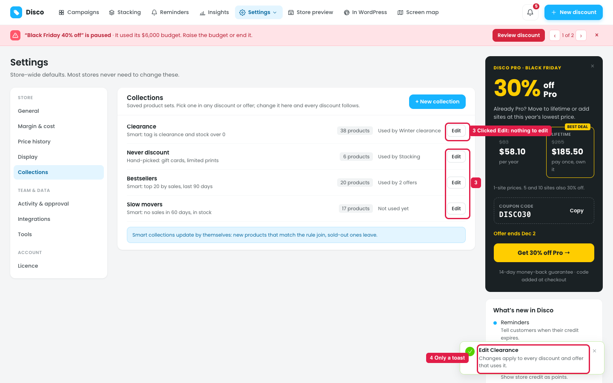

# Settings → Collections: "+ New collection" and "Edit" don't open anything

## How it works

A collection is a saved product set, e.g. "Clearance" or "Bestsellers", that any discount or offer can use. Changing the collection updates every discount that uses it.
- **Hand-picked:** a fixed list of products.
- **Smart:** a rule, e.g. "tag is clearance and stock over 0". Products join or leave by themselves.

## Issue 1: New collection

**Steps:** Settings → Collections → + New collection

1. **Clicking "+ New collection" opens no popup (marker 1).** There's no way to name it, pick products or set a rule, so no collection can be created.
2. **Only a toast appears (marker 2):** "New collection · Pick products by hand, or set a rule (category, tag, price, stock, sales) so it updates itself." It describes the editor but doesn't open it.

## Issue 2: Edit

**Steps:** Settings → Collections → Clearance (or any collection) → Edit

3. **"Edit" opens nothing on any collection (marker 3).** The name, products and rule can't be changed. For a smart collection, the owner can't even see the full rule; only the one-line summary is shown.
4. **Only a toast appears (marker 4):** "Edit Clearance · Changes apply to every discount and offer that uses it." There's nothing to change.

Also missing: there's no way to **delete** or **duplicate** a collection.

## Suggestion

**"+ New collection" and "Edit" open the same popup (or side panel):**

- **Name:** e.g. "Clearance".
- **Type:**
  - ○ **Hand-picked:** product search with checkboxes, using the same "Add a product rule" picker as a discount's Products step, with the Product type.
  - ○ **Smart (updates itself):** rules such as Category, Tag, Price, Stock, Sales in the last [N] days, Top [N] by sales, and Days since added, with **All match / Any matches**.
- **Live result:** "Matches **38 products**", with a short list and "See all".
- **Used by** (Edit only): "Winter clearance, 2 offers". When saving: *"Changes apply to 3 discounts and offers."*
- **Buttons:** Cancel · Save collection.
- **Edit only:** **Duplicate** and **Delete**. If it's in use, block deleting or warn: *"Used by Winter clearance. Remove it there first."*
- **Remove the toasts.**
